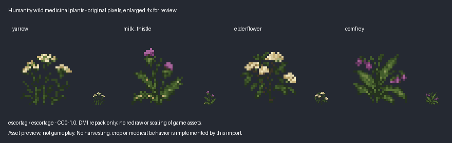

# Civ14 / Humanity art audit and first batch

This batch imports **four wild medicinal-plant images** into
[`icons/farming/humanity_wild_herbs.dmi`](../icons/farming/humanity_wild_herbs.dmi):
`yarrow`, `milk_thistle`, `elderflower`, and `comfrey`.
It is an **asset-only import**. No object definitions, recipes, map placements,
harvesting, crop stages, medical effects or existing sprites change. These are
whole wild plants, not inventory produce or a six-stage farming sequence.

## Exact sources and rights

| Repository | Audited revision |
| --- | --- |
| [Civ13/Civ13](https://github.com/Civ13/Civ13/tree/067478b82c7ad9f1b83759a221e6f22080ba865a) | `067478b82c7ad9f1b83759a221e6f22080ba865a` |
| [Civ13/Civ14](https://github.com/Civ13/Civ14/tree/459f0b9e4fa8efea11da21dbbeb500d6ac500f64) | `459f0b9e4fa8efea11da21dbbeb500d6ac500f64` |
| [escortage/Humanity](https://github.com/escortage/Humanity/tree/33ae051274a4753c7769063577ad30a233c3a74d) | `33ae051274a4753c7769063577ad30a233c3a74d` |

All four images come from Humanity's
[`Resources/Textures/Humanity/Flora/wild_plants.rsi`](https://github.com/escortage/Humanity/tree/33ae051274a4753c7769063577ad30a233c3a74d/Resources/Textures/Humanity/Flora/wild_plants.rsi),
not its similarly named `Civ14/Objects/Farming/*.rsi` packs.
They are absent from the pinned Civ14 tree.

The art and its original per-asset metadata were added in
[`6b5590281ef6dbd7f2c4b3efa5452afedd0194c7`](https://github.com/escortage/Humanity/commit/6b5590281ef6dbd7f2c4b3efa5452afedd0194c7),
authored by GitHub user **escortage** on October 3, 2026. The
[original metadata](https://github.com/escortage/Humanity/blob/6b5590281ef6dbd7f2c4b3efa5452afedd0194c7/Resources/Textures/Humanity/Flora/wild_plants.rsi/meta.json)
explicitly credits **escortag (Discord: escortag)**, says it was created for
Humanity, and dedicates it under **CC0-1.0**. The four PNG blobs are identical at
the origin and audited head. Commit `8a3ffe11ea949071a5b70958c7519ca673469365`
shortened the metadata credit to `escortage`; it did not change the dedication.
Both original and current metadata are preserved with the source files.

This is the upstream authorship assertion supported by Git history, not
independent proof of who drew each pixel. No contrary derivation notice was
found for these four images. Civ13's code license was not used as permission.
The CC0 dedication remains attached to the art; see
[the credit notice](../icons/farming/ATTRIBUTION.md#humanity-wild-medicinal-plants)
and [CC0](https://creativecommons.org/publicdomain/zero/1.0/).

Each source PNG is **32x32, one direction, one frame, with no delay metadata**.
The DMI retains those semantics and state names. Conversion only packs the four
images left-to-right in a 128x32 PNG with DMI 4.0 `Description` metadata.
Every RGBA byte is preserved, including transparent pixels. There is no game-art
scaling, redrawing, recoloring, synthetic animation or generated replacement art.
The labeled review image enlarges real pixels with nearest-neighbor sampling.

## Candidate shortlist and exclusions

The audit prioritized project-specific `Civ14/` and `Humanity/` texture packs,
their per-asset notices, relevant source prototypes and current Civ13 semantics.
It also inventoried the repositories' per-RSI license metadata. It is not a claim
that every inherited SS14 or Stalker asset has been individually cleared.

| Candidate / exact path under `Resources/Textures/` | Evidence and disposition |
| --- | --- |
| Humanity `Humanity/Flora/wild_plants.rsi`: yarrow, milk thistle, elderflower, comfrey | **Selected, CC0-1.0, escortag/escortage.** Distinct white flower clusters, purple thistle, broad elderflower and purple comfrey pixels were inspected. Their Humanity semantics are independent wild medicinal plants in `Resources/Prototypes/Civ14/Entities/Flora/wild_crops.yml`. Civ13 has generic herb crops and healing-herb stacks, but no dedicated world art or object types for these four species. Four prepared world sprites fill this small art gap; future gameplay integration still needs design and tests. |
| Humanity `Humanity/Objects/field_equipment.rsi` | **Shortlisted, deferred.** Per-pack AGPL-3.0 credit to escortage; field dressing, blood flask, sandbag and wire kit world images plus four-direction left/right inhands. Actual pixels inspected; none matched current Civ13 frames in the audit. Civ13 already implements related supplies, so these would need a deliberate existing-item visual use and hand-origin review. No kit or treatment feature is imported. |
| Humanity `Humanity/Flora/reeds.rsi`, `Humanity/Effects/crater.rsi` | **Shortlisted, deferred.** CC0-1.0, escortage. Actual pixels inspected, no current frame match. Reeds could support wetland scenery; crater artwork needs a specific decal use rather than a spare import. |
| Humanity `Humanity/Objects/field_stretcher.rsi` | **Rejected.** Metadata says canvas adapted from Civilization 13, edited by escortage. A lack of identical pixels does not erase that derivation. |
| Civ14 `Civ14/Objects/money.rsi` | **Rejected for this batch.** The `coin_silver_new` image matches Civ13 `icons/obj/items.dmi:yen_50` by decoded visible pixels despite a different state name. The stacked variants are not evidence of a missing currency feature. |
| Civ14 `Civ14/Objects/medals.rsi` | **Deferred.** AGPLv3, Taislin. No current-frame matches, but no identified gameplay art gap justifies importing another medal family now. |
| Civ14 `Civ14/Objects/Farming/{yarrow,elderflower,hemp,flax,juniper,licorice,plants}.rsi` | **Rights/provenance hold.** Pinned Civ14 metadata lacks license/author fields. Humanity adds mixed AGPL-3.0 AND CC-BY-SA-3.0 notices; its yarrow attribution identifies Civ13-derived stages and explicitly unverified `harvest.png` / `produce.png` sources. These are different images from the selected native wild plants. No reliance on a repository default to clear the unverified images. |
| Civ14 `Civ14/Flora/bushes_dry.rsi`, `bushes_snow.rsi`, several exported clothing/animal packs | **Rights/provenance hold or reject as exports.** `None` metadata is not permission. Other packs explicitly say exported/taken from Civ13 and are excluded even when names differ. |
| Branded cigarette packs, logos, and noncommercial/Stalker content | **Excluded.** Unrelated branding and additional rights conditions are outside this narrow batch. |

### Food-work inventory and boundary

At both source heads, `Civ14/Objects/food/` contains seven RSI packs:
`chicken` (29 states), `donuts` (40), `dryed` (31), `dryer` (82), `food` (324),
`food_ingredients` (13), and `tortilla` (11). The sibling `complex_foods.rsi`
has 78 states. All eight per-pack notices say taken from Civilization 13 and
declare AGPLv3. These **608 recorded states are export metadata counts, not 608
new assets**. The wider inherited `Objects/Consumable/Food/` collection also
remains outside this import.

The existing Civ13 Pocket Stronghold turnip/plump-helmet art and its attribution
are retained. No food image, produce, growth stage, food code or existing food
DMI is imported or edited here. Food-sprite port work remains separate. Source
inspection and available PR/branch searches did not identify a separate published
Civ14/Humanity food-port head to verify; this is not a claim about unpublished work.

## Pixel and semantic comparison

The committed baseline contains **475 PNG/DMI sheets and 60,446 decoded frames**
under `icons/`. The reproducible audit compared every stored frame against each
selected image, ignoring state names. It checks full visible RGBA, alpha-bounded
translation and horizontal mirror. All four candidates have **zero pixel matches
and zero matching state names**. It decoded all sheets without errors;
`icons/obj/vehicles/testing.dmi` is explicitly state-less. Two legacy state names
contain control characters, which the parser preserves rather than skipping.

The duplicate check is a rejection aid, not proof of originality. It does not
detect every recoloring, redraw, composited overlay or historically deleted art.
The explicit origin dedication, unchanged PNG blobs, notices, visual inspection
and source semantics support the selected batch together.

Source review confirms Civ13's `/obj/structure/farming/plant/herbs` uses the
existing `herbs-grow*` family and `/obj/item/stack/medical/advanced/herbs` uses
`healing_herbs`. New state names do not replace these or establish new features.
No new obtainable types exist, so `tests/sprites/required-types.json` is unchanged.

## Reproduction and acceptance limits

See [`tools/art_ports/README.md`](../tools/art_ports/README.md) for offline
rebuild, original-source verification, duplicate audit and conversion tests.
The source manifest records SHA-256 and Git blob IDs for each PNG and both rights
metadata snapshots. [`humanity-wild-herbs-audit.json`](humanity-wild-herbs-audit.json)
records the selected-art comparison against the exact Civ13 baseline.

Local checks: nine offline tests pass, including source/license corruption,
unsupported animation/direction metadata, state swap, single-pixel edit, wrong
DMI directions, and renamed/translated/mirrored duplicate controls. Rebuilding
and decoding confirms exact RGBA equality for all four states. The actual source
and final DMI pixels were visually inspected. `git diff --check` passes.

No local BYOND compilation, runtime, server launch or connected-client gameplay
test was run. This unused resource is not referenced by a DME/DM/map change;
compilation would not establish its gameplay integration. Hosted CI and its
selected/skipped scopes must be reported at the PR head separately. The preview
is art evidence, not a gameplay screenshot. Root review and merge decisions remain
separate; this draft performs no merge, deployment or security change.
