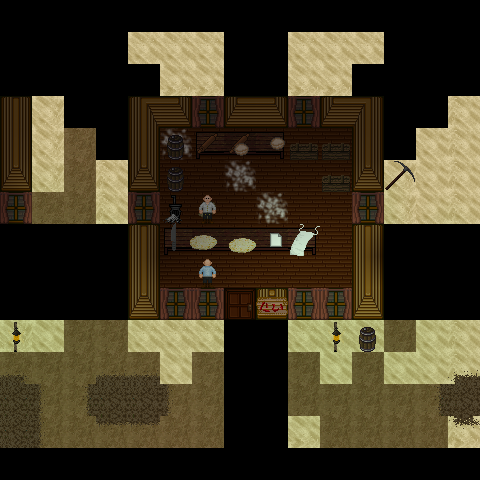

# Reproducing native cloud-rendered Civ13 stills

A disposable GitHub-hosted `windows-2022` runner rendered two genuine **480 x 480
DreamSeeker screenshots** of an isolated Civ13 bakery on 25 October 2026. One
engine-created guest was the stationary camera; two scripted native humans used
the normal pickup, dough recipe, oven cooking and table-transfer handlers.

This is a reproducible **reference implementation**, not an unrestricted reusable
workflow. Its activation identity and time window were one-shot. Prepare and
review a new run as described below; do not rerun, recreate or impersonate the
historical branch/run. This document does not install anything or activate a job.

## Result and immutable reference

| Item | Reference |
|---|---|
| Successful controller | [`8ce9a2257f1250bd21349130a3c10c1516a3bf14`](https://github.com/Civ13/Civ13/commit/8ce9a2257f1250bd21349130a3c10c1516a3bf14) |
| Controller's sole parent | `3f3dd47f614f4659031a793dc590346f5e4de3e6` |
| Pinned Civ13 scene/assets | [`58404f5bd16e3fed80f1d9844c5db3edd144942c`](https://github.com/Civ13/Civ13/tree/58404f5bd16e3fed80f1d9844c5db3edd144942c) |
| Successful native run | [40210982075](https://github.com/Civ13/Civ13/actions/runs/40210982075), attempt 1 |
| Artifact | ID `12605602013`; archive SHA-256 `396de9d7483e320922dc94121d16258039fb3f36a10adc9497e672e66df74247` |
| Runtime | BYOND `516.1688`, Windows Server 2022 hosted runner, Python 3.12 |

Read the pinned [workflow][workflow] and [controller source directory][source].
The directory's old README describes earlier experiments and contains superseded
setup/activation instructions; use this guide and the executable source at the
successful commit instead. Artifacts have seven-day retention and may expire.
The original after screenshot is retained below; the before screenshot is not
included in this guide.

### What the native output established



*Original 480 x 480 DreamSeeker capture from the reference run above. Two scripted
native actors are visible after cooking and transfer; this is a staged still,
not video, ordinary-player acceptance or evidence of public-server hosting.*

The first still showed the authored bakery before scripted actors and recipe
preparation. Existing map props are not evidence of newly cooked food. The second
still showed two scripted native actors. Native assertions, not pixels alone,
established paid ingredients, the real cooking timer and transfer of the same
freshly cooked bread. Black outside-map/occluded regions remained. These were
native staged captures, not reconstructed artwork or ordinary-player footage.

This proves the bounded staged still-capture path. It does **not** establish
sustained video, ordinary player input, a live multiplayer round, full production
startup, performance, or deployment to Gaia or any public server. It does not
identify every proprietary engine behavior or external endpoint's purpose.

## 1. Prerequisites and fresh-run configuration

Use a disposable hosted Windows runner with an active, accessible input desktop,
Git and Python 3.12. The tested runner label is not a permanent OS image pin:
future images can change dependencies and graphics behavior. Keep the runtime
checks and treat an image change as new evidence, not automatic compatibility.

Before running, the operator must be permitted to acquire/use BYOND, accept the
bundled Microsoft DirectX terms, install that exact runtime on the disposable
machine, and allow the narrowly monitored TCP behavior described below. No
personal BYOND account, production data, repository secret or browser login is
needed. Do not use this as a production installation recipe.

Create a fresh source proposal in a repository you control, initially without an
active matching trigger. Copy the complete tooling directory and workflow from
the pinned controller, not just `run_scene.py`. Retain all tests and manifests.
Configure the following together, then review the resulting complete source:

| Binding | Where to configure it for your new run |
|---|---|
| Repository, fresh unique branch, exact publication message | Workflow `on.push` and job `if`; repository/branch guards in `run_scene.py` and `directx_setup.py` |
| Reviewed sole parent and initial publication | Workflow ancestry and `EVENT_BEFORE` checks; retain attempt-1-only admission |
| Allowed execution window | `run_scene.py` `OUTBOUND_DEADLINE`, its descriptive receipt string and corresponding tests; require at least five minutes remaining at admission and enforce expiry while running |
| Source/runtime | Keep scene revision, derivative manifest and vendor pins below for this replication; review/reseal any intentional source change instead of disabling checks |
| Budgets and artifact policy | Preserve workflow timeouts, process/CPU/memory limits, socket guards, exact capture and cleanup checks |

Do not spoof `GITHUB_*` or runner variables to satisfy admission, remove expiry
checks, relax protections, reuse a consumed branch, or turn on automatic retries.
A fork must bind to its actual permitted repository and new publication identity.
Update source-contract tests to the new identity; their negative checks must
still reject wrong repositories, branches, attempts and expired windows. Publish
only the reviewed new proposal when authorized. Historical permission and
successful receipts do not authorize someone else's future run.

## 2. Acquire exact source and complete project resources

For **source inspection only**, these commands retrieve the reference controller
and separate scene checkout without launching BYOND (PowerShell, fresh paths):

```powershell
git clone --no-checkout https://github.com/Civ13/Civ13.git capture-reference
if ($LASTEXITCODE -ne 0) { throw 'Clone failed' }
git -C capture-reference checkout --detach 8ce9a2257f1250bd21349130a3c10c1516a3bf14
if ($LASTEXITCODE -ne 0) { throw 'Controller checkout failed' }
git -C capture-reference worktree add --detach ../scene-reference 58404f5bd16e3fed80f1d9844c5db3edd144942c
if ($LASTEXITCODE -ne 0) { throw 'Scene checkout failed' }
```

The hosted workflow checks out the newly reviewed controller SHA and the separate
pinned scene revision. It then materializes exact committed bytes using
`git ls-tree` and a retained `git cat-file --batch` process, checking blob identity,
type, size and framing. **Do not replace this with a Windows working-tree copy or
`git archive`**: Git conversion settings changed bytes in earlier experiments.
Preserve original LF and CRLF bytes rather than normalizing pins.

`stage.py` exports exactly **3,673 allowlisted source/resource blobs, 241,269,067
bytes**, then applies the 17 hash-checked isolated overlay files in
`derived-source.json`. Keep the whole manifest-selected `code`, `icons`, `sound`,
`UI`, `interface`, public `config/names`, and environment file. The DME includes
only `filming/bakery.dmm`: a 15 x 13 crop of authored Little Creek bakery tiles.
No production configuration, account, save or running world is imported.

Relevant manifest SHA-256 values:

- `v4-source-manifest.json`: `c09f581770e2a76cf0be71696fce31afc2e5ef3b8e32e3cb9886785a6030430b`
- `derived-source.json`: `9d990c9e07fccfd98f34d12dcf2eb27cdb1d7491c031a1868882d6aa22ad2a6d`
- `vendor.json`: `c8900f77f5db139dde7dc964e8667da330681688869e4fb2db42bc6b1df690f9`

The reduced fixture retains required native initialization, including publishing
`GLOB = src` through the global controller constructor and initializing its
sticker registry. It does not invoke full production startup. Production
shell/export entry points have throwing isolation stubs; preserve them and the
runtime-error stop path. Compile success alone is not scene readiness.

## 3. Acquire BYOND and set up DirectX

The successful acquisition used this [community mirror ZIP][package], not a
vendor-signed checksum service. Its 45 files matched the pinned package manifest;
all notices were retained. Prefer the verified package route in the controller;
do not substitute arbitrary DLL downloads, alternate installers or guessed URLs.
An HTTP denial, hash mismatch or security prompt is a stop condition, not a reason
to bypass TLS, proxy policy or machine protections.

| Material | Bytes | SHA-256 |
|---|---:|---|
| `516.1688_byond.zip` | 8,602,470 | `9079f29b0747719233715dfeff223641e6fb69bd16b8ba9676d5cd42cfcd0148` |
| Bundled `DXSETUP.exe` | 537,432 | `046041aba6ba77534c36bb0c2496408d23c6a09f930c46b392f1edc70dfd66de` |
| Installed x86 `d3dx9_43.dll` | 1,998,168 | `0b28546be22c71834501f7d7185ede5d79742457331c7ee09efc14490dd64f5f` |
| Installed x86 `D3DCompiler_43.dll` | 2,106,216 | `2f23182ec6f4889397ac4bf03d62536136c5bdba825c7d2c4ef08c827f3a8a1c` |

`acquire.py` performs a single bounded HTTPS download, verifies size/hash and
validates every extracted file and notice in a fresh directory. The archive is
limited to 128 entries, 64 MiB unpacked, 32 MiB per file and an expansion ratio
of 500. Links, reparse points and unexpected paths/files are rejected.

Static PE checks require the **x86** VC/MFC runtime (`mfc140u.dll`,
`vcruntime140.dll`, `msvcp140.dll`) and other listed dependencies. Stop if absent;
this recipe does not silently install additional runtimes. An x64 DLL with the
same name is not a substitute. Static import checks do not establish successful
graphics, dynamic loading, WebView2 or audio initialization. The skin uses no
browser control.

The successful path ran the **exact bundled Microsoft `DXSETUP.exe /silent`**
through `directx_setup.py`, after explicit terms acceptance. This is a system
runtime installation, unlike extracting the BYOND ZIP. It uses a retained Job,
60-second work budget plus five seconds cleanup, no elevation/reboot/alternate
installer, and verifies both installed x86 system DLL hashes. A receipt is bound
to the current controller/run/attempt/job/ref and reverified before compilation.

An earlier app-local extraction of `d3dx9_43.dll` was not enough to demonstrate a
working renderer. Subsequent successful setup and rendering support using the
bundled setup path; they do not prove the complete cause of every earlier crash.
Do not replace the successful path with the old README's extraction-only advice.

## 4. Execute the bounded pipeline

The following are the commands used **inside the newly configured hosted
workflow**, after its admission checks. They are not a local shell bypass for the
historical identity. Keep the pinned checkout/setup/upload Actions from the
reference workflow and check every exit status.

```powershell
# Controller checkout is GITHUB_WORKSPACE; scene checkout is source-checkout.
python -B tools/cloud-bakery-5161688/materialize.py --repository "$env:GITHUB_WORKSPACE" --revision "$env:GITHUB_SHA" --destination "$env:RUNNER_TEMP/bakery-tooling"
if ($LASTEXITCODE -ne 0) { exit $LASTEXITCODE }
Set-Location "$env:RUNNER_TEMP/bakery-tooling"
python -B -m unittest discover -s tools/cloud-bakery-5161688 -p 'test_*.py' -v
if ($LASTEXITCODE -ne 0) { exit $LASTEXITCODE }
python -B -m unittest discover -s tools/cloud-bakery-5161688/tests -p 'test_capture.py' -v
if ($LASTEXITCODE -ne 0) { exit $LASTEXITCODE }
python -B tools/cloud-bakery-5161688/stage.py --repository "$env:GITHUB_WORKSPACE/source-checkout" --destination "$env:RUNNER_TEMP/bakery-source"
if ($LASTEXITCODE -ne 0) { exit $LASTEXITCODE }
$engine = Join-Path $env:RUNNER_TEMP 'bakery-engine'
if (Test-Path -LiteralPath $engine) { throw 'Fresh engine directory required' }
New-Item -ItemType Directory -Path $engine -ErrorAction Stop | Out-Null
python -B tools/cloud-bakery-5161688/acquire.py --root "$engine"
if ($LASTEXITCODE -ne 0) { exit $LASTEXITCODE }
# Only after the operator has accepted the bundled Microsoft terms:
python -B tools/cloud-bakery-5161688/directx_setup.py --root "$engine" --output "$engine/directx-evidence" --accept-bundled-microsoft-directx-terms
if ($LASTEXITCODE -ne 0) { exit $LASTEXITCODE }
python -B tools/cloud-bakery-5161688/run_scene.py --binary "$engine/byond/bin" --source "$env:RUNNER_TEMP/bakery-source" --output "$env:RUNNER_TEMP/bakery-evidence" --execute-reviewed-scene
if ($LASTEXITCODE -ne 0) { exit $LASTEXITCODE }
```

Keep these as separately timed workflow steps as in the reference, not one
unbounded command block: tooling/tests one minute each, source/package/setup two
minutes each, native scene four minutes, whole job **15 minutes**. The controller
shares **165 seconds of work plus 15 seconds cleanup** across compiler/server/
client. Cooperative checks cannot preempt every blocking OS call; workflow
timeouts are the outer boundary. Offline tests are not native acceptance.

### Owned server and guest, not a public test server

The controller launches `dm.exe -max_errors 0 civ13.dme`, requires the exact
`516.1688` banner and `0 errors, 0 warnings`, and seals the resulting DMB/RSC. It
then chooses an unprivileged loopback port and internally launches:

```text
dd.exe civ13.dmb <port> -ip 127.0.0.1 -invisible -trusted -nowebclient -params observer_mode=engine_guest_camera&filming_port=<port>
dreamseeker.exe byond://127.0.0.1:<port>##guest
```

These explain the controller's arguments, not commands to run without its guards.
`-trusted` is limited to the reviewed fixture's local-file needs; it is not a
sandbox. The fixture must admit exactly one genuine engine Guest with the correct
build and loopback address. A login prompt, extra window, incorrect build or
unexpected child stops the run. The camera remains at `(7,7,1)`.

Each compiler/server/client gets a separate retained Windows Job **before resume**:
kill-on-close, one process, 512 MiB process memory and 60 seconds process CPU.
The watcher is bounded to 128 MiB and requires 2 GiB free RAM before launch.
Ownership uses retained handles plus image/PID/creation time, never adopting a
process by name or PID alone.

The game listener must be exactly the selected `127.0.0.1` port. DreamSeeker also
required one client-owned loopback TCP listener in `49152..65535`, distinct from
the game port; its first observed port is pinned to that client's lifetime.
Changed/additional/non-loopback listeners, UDP and stale ownership fail closed.
The permitted native server/client TCP capability is **not zero egress**. Setup
has its own non-listening TCP policy; compiler policy remains stricter.

Socket monitoring samples global OS TCP/UDP tables, immediately filters owned
rows and rechecks retained handles; unrelated rows are not persisted. These are
sampled checks, not continuous OS network isolation or verified endpoint
attribution. No firewall, authentication, TLS or account settings are changed.

## 5. Fixes that made the scene capturable

### Clear special verb lists without cutting or replacing them

Native startup rejected `verbs.Cut()` on the client's special list; assigning a
new list in observer Login also failed to empty the inherited verbs. Both sites
now iterate a stable copy and subtract from the original:

```dm
for (var/fixture_verb in verbs.Copy())
    verbs -= fixture_verb
```

Keep the empty-client checks before and after parent `New()`, and the empty
observer checks after Login and before capture. Do not simply omit the assertions
or allow inherited commands. The relevant list operations are described in the
[BYOND programming guide, chapter 10][lists].

### Explicitly disable the MAIN status bar

A nominal 480 x 480 skin did not initially produce the required top-level client
rectangle. Child-window geometry diagnostics exposed the discrepancy. Set the
MAIN control's `statusbar = false` explicitly, retain `can-resize = false`, and
keep both MAIN and MAP at `480x480`, with MAP at `0,0`. Native checks then obtained
exactly `(0,0,480,480)`. Do not resize the window from the controller, capture a
convenient child instead, or crop away a geometry failure.

### Let the authored DMM determine all world dimensions

Earlier witnesses found default dirt at z1 and the authored bakery at z2 in a
15 x 13 x 2 world. Changing **only `maxz = 0` did not fix it** while nonzero
`maxx/maxy` declarations remained. The successful fixture removes **all three
manual world dimension declarations**, with no runtime resize or map rewrite.
The sole authored DMM then loaded as **15 x 13 x 1**, and every required z1
witness passed before fixture initialization, after initialization and at client
admission. This follows the [BYOND guide's map-driven sizing advice][dimensions].

The observed before/after results justify this fixture correction, not a claim
to know BYOND's internal placement algorithm. Do not move the camera to z2,
construct replacement floors/objects, weaken witnesses or alter lighting merely
to conceal a misplaced map.

All six witnesses must have area `/area/caribbean/desert/buildings` at z1:

| x,y | Turf | Required object (if any) |
|---|---|---|
| 7,7 | `/turf/floor/wood_broken` | `/obj/structure/table/wood` |
| 6,8 | `/turf/floor/wood` | `/obj/structure/oven` |
| 7,8 | `/turf/floor/wood` | None required |
| 7,6 | `/turf/floor/wood` | None required |
| 5,11 | `/turf/wall/wood` | None required |
| 8,5 | `/turf/floor/wood` | `/obj/structure/simple_door/key_door/anyone/wood` |

## 6. Capture, verify and clean up

After real guest admission, the controller waits a monitored two-second render
settle and captures the first frame. Only successful capture writes the marker
that permits actor/recipe preparation. The staged actors pay five water and five
flour through the normal dough recipe, load and ignite the oven with normal
handlers, wait its real cooking timer, then transfer the same freshly cooked
flatbread via the table. The second frame follows the bound take receipt.

Capture reads actual screen pixels with `BitBlt` from only the owned top-level
client's exact 480 x 480 rectangle. It checks active session/input desktop,
window title/ownership, foreground, geometry, screen bounds and a 9 x 9 occlusion
sample grid immediately before and after capture. Input-desktop access denial is
terminal. There is no whole-desktop, offscreen, PrintWindow or generated-image
fallback. Pixel-diversity/nonblank checks are heuristics; inspect both actual
images. Sampled guards are not an atomic desktop lock.

The success checklist is deliberately stricter than a green workflow:

- [ ] Controller/scene/package manifests and actual execution-source hashes match
      the reviewed run; setup receipt is bound to this same run.
- [ ] DirectX setup passed with exact installed DLL hashes; compiler banner,
      exit status and zero-error/zero-warning result passed.
- [ ] `filming-checks.txt` shows 15 x 13 x 1 and all six turf/area/object witnesses
      at all three checkpoints, followed by genuine guest and empty-verbs checks.
- [ ] Native recipe, fuel, real cooking-time and same-bread transfer assertions
      passed; `filming-take.json` identifies engine/source and scripted scope.
- [ ] `receipt.json` says `PASS_NATIVE_CIV13_BAKERY_STILLS`; both captures are
      480 x 480, owned-client screen captures with different pixel hashes.
- [ ] Visual inspection finds the authored bakery and actors, not merely nonblank
      pixels; any partial/failed-diagnostic frame remains failure evidence.
- [ ] Installer, compiler, server and client all confirm exit and retained-handle
      cleanup. Cleanup errors or work-budget overruns must not become PASS.
- [ ] Only allowlisted regular evidence files are retained: at most 19 files,
      1 MiB each and 5 MiB total, with seven-day artifact retention. Do not upload
      BYOND binaries, runtime profile/cache directories or raw OS socket tables.

For the reference PNGs, `Get-FileHash -Algorithm SHA256 <file>` must produce:

| File | Bytes | SHA-256 |
|---|---:|---|
| `bakery-before.png` | 174,471 | `bf996b3f96ce1ebd9f57870a4670ea861ae7737fecd4a75a9e21791603920a57` |
| `bakery-after.png` | 175,951 | `f272d0922cb0505e028dae768db13086a58e072c7fae94d10b9134db1772ac2c` |

Future correct renders need not be byte-identical: native timing/animation can
change pixels. Verify their own receipt hashes, dimensions, ownership, witnesses
and semantics. The downloaded reference artifact archive has its separate hash
listed above; it is not the hash of either image or a recompressed archive.

Cleanup terminates/closes only owned Jobs and confirms signaled process handles,
reads exit codes, closes thread/process handles, releases GDI/input-desktop
handles and restores DPI state. A terminated server/client can have a nonzero
exit code even after successful captures; inspect the cleanup result rather than
requiring natural game exit. Preserve bounded failure evidence, then dispose of
the runner. Do not kill unrelated processes or reuse profile/output directories.

## Troubleshooting without hiding failures

| Symptom | Next diagnostic / correct response |
|---|---|
| Source hash differs only on Windows | Check raw-blob materialization, not newline normalization or rewritten pins. |
| Missing DMI/resource/include | Restore the complete manifest-selected source tree; do not invent substitute assets. |
| Compile error or startup exception | Read bounded compiler logs and `filming-stop.txt`; repair the isolated source and review a fresh run. A later missing-listener error can be secondary. |
| Loader error / immediate client crash | Check exact x86 dependencies and same-run DirectX receipt. Owned crash-event diagnostics can be unavailable or ambiguous; a faulting module is not proof of root cause. |
| Socket guard refusal | Read the bounded owned-row diagnostic and ownership binding. Do not whitelist a shared IP, disable monitoring or infer endpoint purpose from an address. |
| Wrong window rectangle | Read the exact parent/child geometry; verify MAIN `statusbar = false`, not only MAP size. |
| Default dirt / blank map | Inspect dimensions and fixed z1/z2 witnesses before changing camera or lighting; omit all manual fixture dimensions. |
| Security warning, login prompt, desktop denial, extra window | Stop and retain the bounded diagnostic. Do not click through, alter security settings or capture another desktop. |
| Flat/black image despite passing compile | Compilation is not rendering. Keep ownership/visibility/pixel guards, examine map readiness and actual pixels; do not label a diagnostic PNG as success. |
| Timeout, cleanup failure, partial first image | Retain as failed/partial evidence. Diagnose first, then make a separately reviewed fresh run; do not rerun the consumed identity. |

[workflow]: https://github.com/Civ13/Civ13/blob/8ce9a2257f1250bd21349130a3c10c1516a3bf14/.github/workflows/cloud-bakery-5161688.yml
[source]: https://github.com/Civ13/Civ13/tree/8ce9a2257f1250bd21349130a3c10c1516a3bf14/tools/cloud-bakery-5161688
[package]: https://cmss13-devs.github.io/byond-build-mirror/download/build/516/516.1688_byond.zip
[lists]: https://secure.byond.com/docs/guide/chap10.html
[dimensions]: https://www.byond.com/docs/guide/chap08.html
