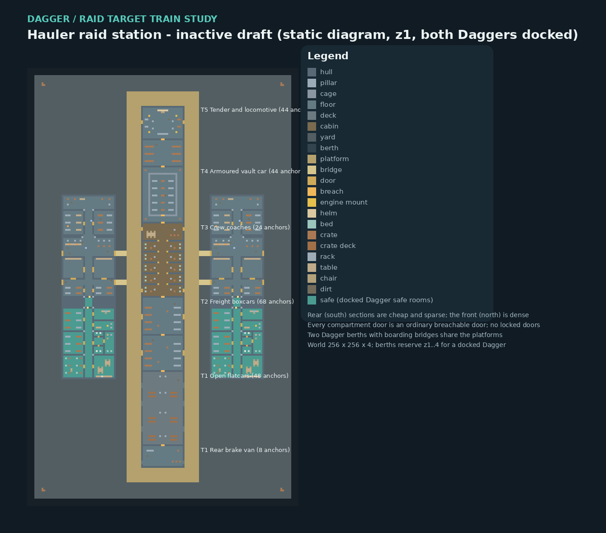

# Dagger raid target train: Hauler station draft

This is an **inactive map study** that completes the geometry the
[Dagger home draft](dagger-train-map.md) leaves open: the target train the
Dagger raids, its breachable compartment doors, and the station where two
Daggers dock beside it. It is editable DMM output plus a declarative layout
manifest, generated by `tests/dagger_map/build_raid_train.py`. It is not
selectable, loads no saves, and adds no fuel, boarding pass, loot table,
timer, controller, NPC or transport callback. The geometry is original Civ13
work using existing turf and furniture types; the long freight train and
tiered sections are genre-inspired, not copied from another game's map.



## Layout

One **256 x 256 x 4** staging map. On z1 a **24 x 200 tile** target train, the
"Hauler", runs north-south at x113..136, y29..228 with its rear at the south
end and its locomotive at the north end. Two 8-wide station platforms flank
it at x105..112 and x137..144 for the full train length, joined by a south and
a north platform head. Two Dagger berths sit outside the platforms with the
same 30 x 102 x 4 footprint and boarding bands as the home draft; z2..4 hold
only the berth volumes for a docked Dagger's upper decks and roof.

| Section (rear to front) | Local y | Tier | Platform access | Loot anchors |
| --- | --- | ---: | --- | ---: |
| Rear brake van | 0..11 | 1 | Open gap, both sides | 8 |
| Open flatcars | 13..52 | 1 | Three open gaps, both sides | 48 |
| Freight boxcars | 54..93 | 2 | Two sliding doors per side | 68 |
| Crew coaches | 95..134 | 3 | Doors at both ends, both sides | 24 |
| Armoured vault car | 136..165 | 4 | None; couplings only, inner cage door | 44 |
| Tender and locomotive | 167..199 | 5 | Cab doors, both sides | 44 |

Each section is separated by one full-width coupling row with a two-tile
`breach` door at x11..12. The vault cage, the boxcar partition and the
locomotive bulkhead use the same breachable door placeholder. **No locked door
exists anywhere on the Hauler.** The pass gates the entry transaction for a
target section; it must never become a lock on target compartments, and the
target structure never inherits the Dagger's protected-boundary rules.
Tier is loot quality ordered rear to front; anchor counts are the furniture
positions (crates and racks) that a future loot population system may fill.
Neither tier nor count chooses a table, price, fuel quantity or timer.

| Slot ID | Ground world origin | Inclusive reservation | Boarding ports | Bridge |
| --- | --- | --- | --- | --- |
| `raid_west` | (69,78,1) | x63..104, y72..185, z1..4 | x98, y130..132 and y146..148 | x99..104 |
| `raid_east` | (151,78,1) | x145..186, y72..185, z1..4 | x151, y130..132 and y146..148 | x145..150 |

Both reservations are disjoint from each other, from the platforms and from
the train. Each berth atomically reserves only its own footprint; the other
berth stays available to another party while the first is docked. Static
composition overlays both complete four-level Dagger drafts and checks that
every boarding port still routes to the platform.

## Raid entry and extraction contract

Unchanged from the home draft: raid entry requires loaded fuel and a boarding
pass for the selected target section, with better loot and higher cost toward
the front. Reservation, call, arrival, boarding and departure must each be
server-authoritative and revalidated. This map records those as declarative
requirements with `enforced_by_this_map: false` and chooses no values.

## Files and verification

- `maps/WIP/dagger_raid_train.dmm` and `.layout.json`: generated; edit the
  generator and regenerate.
- `tests/dagger_map/validate_raid_train.py`: DMM and layout validator.
- `tests/dagger_map/test_raid_train.py`: static checks and mutation controls.
- `tests/dagger_map/preview_raid_train.py`: source diagram export (Pillow).
- `tests/dagger_map/compile_map.py --map raid`: native compile-only harness.

```sh
python3 tests/dagger_map/build_raid_train.py --check
python3 tests/dagger_map/validate_raid_train.py
python3 -m unittest discover -s tests/dagger_map -p "test_*.py" -v
python3 tests/dagger_map/compile_map.py --byond-bin /path/to/byond/bin --evidence-dir /fresh/dir --map raid
```

Static checks cover literal DMM overrides, deterministic output, hull closure
with only the declared side openings, coupling rows that are hull except for
breach doors, the absence of any locked door, section order with
non-decreasing tiers and a denser front than rear, exact loot anchor lists,
every section and anchor reachable from the platform, closed breach doors
separating neighbouring sections, connected platforms, empty berth footprints
on all four decks, disjoint reservations, bridges that join each boarding port
to the platform, both Daggers docked at once, and the declared structure lists.
The `Dagger map static checks` workflow runs them beside the home checks, and
the opt-in `dagger_map_compile` CI step now compiles both drafts. The compile
harness swaps the marked production map-selection block and requires the
pinned compiler banner with zero diagnostics plus the exact missing-type
failure pair. None of this executes constructors, doors, loot, movement,
transactions or any gameplay.
