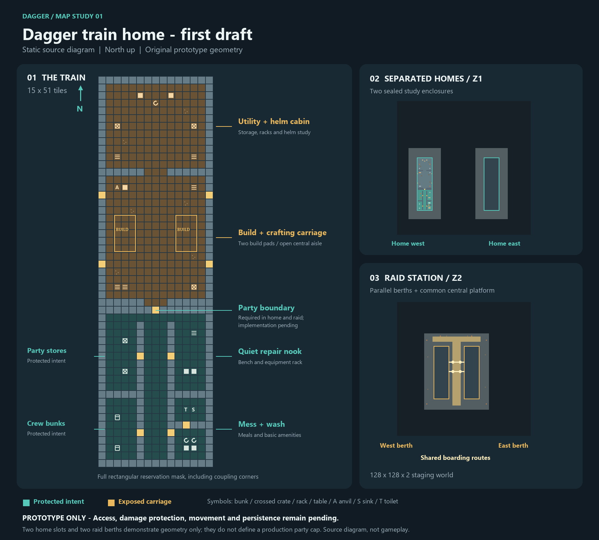

# Dagger train home: first map draft

This is an **inactive map study**, with editable DMM output and a declarative
layout manifest. It is not selectable, does not load player saves, and adds no
shuttle controller or transport callback. The prototype is original Civ13
geometry using existing Civ13 turf and furniture types.



## Layout

The train occupies a fixed **15 x 51 tile** rectangle, facing north. A three-tile
central passage links its carriages. One **128 x 128 x 2** staging map contains
the prototype at a western home slot on z1, an empty eastern home slot, and two
empty raid berths on z2. Both z-levels have equal dimensions. The two home slots
demonstrate isolation and reuse requirements; they do **not** establish a
production train, crew, bed, or party-size cap.

| Local space | Purpose | Required protection |
| --- | --- | --- |
| Rear compartment, y0..20 | Crew bunks, mess/wash nook, party stores and quiet repair nook | Owning party only, including while raid-docked |
| Centre carriage, y22..37 | Two 3 x 5 build pads, salvage racks, anvil/work surface and boarding cross passages | Exposed to boarding and looting |
| Forward cabin, y39..49 | Utility stores and proposed helm position | Exposed |

The layout gives stored gear, sleeping space, basic repair and dining separate
rooms. Larger construction is placed in the exposed carriage. Four side ports
at local y26 and y35 support two approaches on either side; each raid berth has
two boarding links to the common platform. Build pads sit outside the central
passage and both boarding cross passages. Worn floor patches and displaced
station cargo suggest a repaired, scavenged train rather than a pristine base.
The draft does not grant free production resources or decide starter inventory:
these are prototype furniture placements, not an accepted economy loadout.

The protected compartment has no exterior door. Its single gate is local
`(7,20)`. A closed-gate static route check must separate exposed and protected
floor. **The ordinary locked door in the DMM is only a visible boundary marker.**
It is not party authorization, invulnerability, or an accepted lock mechanic.
Runtime protection must cover entry, remote interactions, projectiles, damage,
contents, construction and other relevant paths, with the party check unchanged
when docked. The map must remain inactive until those contracts are implemented.
The player's confirmed protected-compartment rule is independent of Enginefall.

## Files and coordinate contract

- `maps/WIP/dagger_train_home.dmm`: native editable map source, generated from
  `tests/dagger_map/build_map.py`; edit the generator and regenerate together.
- `maps/WIP/dagger_train_home.layout.json`: versioned, API-neutral static data.
- `tests/dagger_map/validate_map.py`: DMM and layout validator.
- `tests/dagger_map/test_layout.py`: focused static checks and mutation controls.
- `tests/dagger_map/preview.py`: source diagram export; it is not a native render.

Local coordinates start at the southwest tile `(0,0)`. World coordinates are
BYOND's one-based `(x,y,z)`. The transform is `world = slot.origin + local`;
the origin is a world coordinate, not a tile offset to be incremented again.
Only zero-degree rotation is described by v1. Bounds are inclusive. Mask rows
are explicitly ordered **south to north**, unlike DMM text rows, which are
written north to south. Every mask bit belongs to the moved rectangle, including
the hull and the filled corners around coupling passages.

| Slot ID | World origin | Inclusive reservation on that z |
| --- | --- | --- |
| `home_west` | (20,24,1) | x17..37, y21..77 |
| `home_east` | (84,24,1) | x81..101, y21..77 |
| `raid_west` | (36,36,2) | x33..53, y33..89 |
| `raid_east` | (65,36,2) | x62..82, y33..89 |

Each named slot supplies its own berth mask and anchor. The two raid reservation
rectangles are disjoint, as are their translated 15 x 51 arrival footprints.
Their exposed sides face the shared x54..61 platform. Bridge cells are world
triples outside the arrival masks; the destination floor is empty of furniture
and actors in the draft. Two arrivals can geometrically fit at once. That is
not evidence that concurrent loading or travel is safe.

`berth_geometry_groups.raid_pair_v1` links `raid_west` and `raid_east` for
cross-berth geometry validation only. **Each train/party atomically reserves
only its selected berth and its own whole footprint.** The second berth stays
available for another party to arrive while the first train is docked. The
geometry group grants no exclusive occupancy or lease over both berths. The
manifest's `reservation_policy` declares this requirement; it does not implement
a lock. Partial acquisition of the selected berth/footprint must not permit
construction, loading or placement.

The static template ID identifies a version of the design. It is **not a saved
train identity**. The manifest deliberately contains no sample persistent
train or crew ID to accidentally reuse. Future runtime IDs must survive slot
changes and restart independently of coordinates, DMM area names and temporary
round-party objects. Exact mask membership must be authoritative; an area-type
search is not an instance lookup.

## Existing movement code and integration boundary

Source inspection against base `7ebba01cb9e91176c81cc4a8af5f8e0d57ec4b6b` found:

- `code/modules/1713/trains.dm` moves individual train atoms and their followers,
  riders and registered cargo. Its collision and cycle checks do not relocate
  a multi-tile home or reserve a destination footprint.
- `code/modules/multiz/area_teleporter.dm` changes object/mob z coordinates after
  a delay. It preserves absolute x/y, does not move turfs, and has no destination
  reservation, unique-target enforcement, party policy or durable rollback.
  None of its teleporters or controllers is placed here.
- `code/_helpers/areas.dm` converts area instances to types before collecting
  matching areas. This cannot select one player's train by itself.

The Extraction branch has additional car-specific codecs and transfer helpers;
they are not a train ABI in this master-based map draft. No shared train,
vehicle, shuttle, save, map-selection, or persistence source is changed here.
No Baystation or other server source/assets were imported; an external reuse
proposal would need a separate license and attribution check first.

The mechanics/persistence owner must implement reservation before constructors,
loading, or movement; exclusive custody of each train; stable IDs and schema/
generation fences; occupancy revalidation after callbacks; rollback or explicit
quarantine; recovery after interruption; and verified empty-slot retirement and
reuse. The allocator must bound active instances, world allocation and work,
without treating this two-slot demonstration as the production quota. Durable
claims must prevent two trains taking one berth and one train appearing twice,
while allowing different parties to occupy the two distinct berths together.
The existing area teleporter must not be substituted for these contracts.

## Verification and next acceptance work

From a verified Python installation, run:

```powershell
py -3 tests/dagger_map/build_map.py --check
py -3 tests/dagger_map/validate_map.py
py -3 -m unittest discover -s tests/dagger_map -p "test_*.py" -v
```

The source preview additionally requires Pillow. Static checks cover encoded
DMM dimensions, tile definitions, deterministic output, disjoint slot masks,
empty arrival footprints, declared routes, protected boundary topology and
inactive integration. Deliberately overlapping or obstructing data must be
rejected. These checks do not execute DM, constructors, doors, party checks,
crafting, saves, movement or transactions.

The `Dagger map static checks` workflow uses the existing CI suite-selection
policy: it runs this newly introduced suite on the introducing PR, then becomes
opt-in through `workflow_dispatch`. It performs only the three static commands
above; the existing production compile does not include this inactive WIP map.

Native acceptance belongs to the separate mechanics/persistence work: two
different crews, simultaneous arrivals, occupied destination rejection before
construction, unrelated contents preserved, repeated home/raid return with
unchanged train/contents identity, protected-compartment access and damage while
docked, interrupted movement and save recovery, quota exhaustion and safe reuse.
This draft supplies the geometry for those checks, not their implementation.

## Inspiration

Enginefall's [official description](https://www.enginefall.com/) presents Dagger
shuttles as homes and raid transport alongside larger trains. Its [June playtest
post](https://www.enginefall.com/blog/welcome-to-the-enginefall-summer-playtest)
also describes early Dagger bases and combat. Those are concept references;
this draft copies no map or artwork and adopts no inferred protection, crew-size,
loss, economy or ownership-transfer rules from them.
