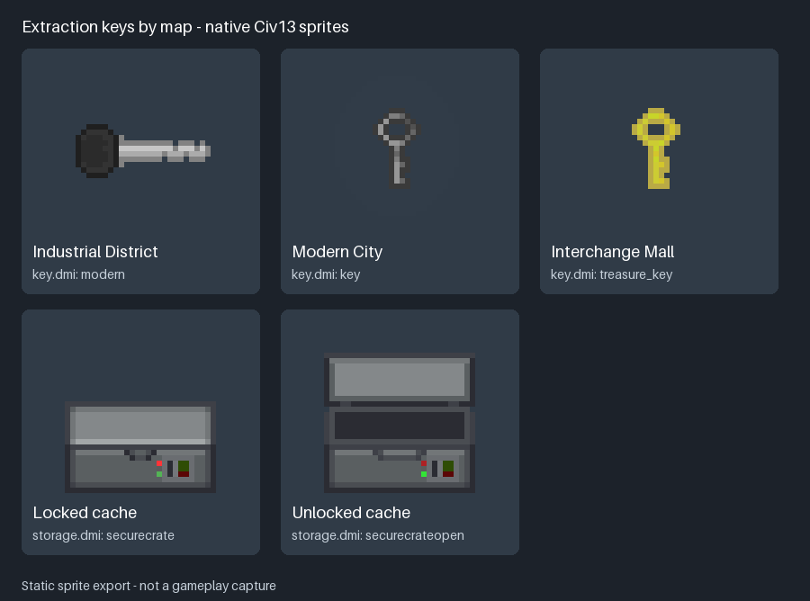

# Extraction container keys

Every current Extraction map has two locked caches. Each key opens exactly one
named container on one map. A foreign-map key is ordinary recoverable equipment:
extract or ship it home, retain it in storage, and carry it on a later raid.
Container keys have three uses. One successful unlock spends one use; reopening
that same cache during the same loot epoch does not spend another. The final
use removes the key. The unlocked cache is shared raid loot.

Keys have a distinct sprite for their intended map: Industrial District uses a
black-handled modern key, Modern City a silver skeleton key, and Interchange Mall a gold
key. Both container keys for a map share that map's sprite; their names identify
the exact lock. Existing saved keys adopt the correct sprite when loaded without
changing their identity, target or remaining uses.

The shared loot integration rolls a 1% bonus chance when an ordinary container's
loot is first planned. A successful roll selects one of all six key types with
equal weight, regardless of the current map. There are no fixed container-key
spawns. Plans contain at most four outcomes and only one bonus key. Locked
caches do not roll bonus keys. These are initial implementation values, not
playtested balance claims.

| Map | Exact container | ID | Separate reward table |
| --- | --- | --- | --- |
| Industrial District | Southwest maintenance stock cage | 61 | Workshop salvage, steel, copper |
| Industrial District | Central dispatch reserves locker | 62 | Gasoline, cloth, leather |
| Modern City | Southwest pharmacy treatment cabinet | 61 | Bandages, splints, cloth |
| Modern City | North central evidence locker | 62 | Pistol, magazines, gold |
| Interchange Mall | Transit security cache, retail floor | 61 | Kevlar, pistol, magazines |
| Interchange Mall | Foundry hardware reserves, retail floor | 62 | Cable, glass, copper, optic |

Each named table has independent weights and two or three guaranteed draws.
Repeated rewards are possible. IDs are unique within each map and remain below
the existing 64-container limit. Ordinary loot placements remain in place.

## Integration contract

`container_keys.dm` owns the bounded key catalog, immutable type-default targets,
three-use limit, six mapped subtypes and six reward tables. An uncatalogued subtype
or unknown pool must fail closed. Generic numeric door codes are not authority:
the key family explicitly inherits `/obj/item`, so generic keys, doors and closet
re-keying do not recognize these items. The historic secure-room extraction key
is separate.

The shared equipment codec must store `uses_remaining` and reject missing,
fractional, exhausted or over-limit values. Map and target are never mutable
account fields. Nested bags, extraction, shipment and vehicle cargo use the same
equipment graph and item identity. Keys are not insurance-eligible.

The shared loot journal owns access and charge consumption. It validates the
actual carried key, actor/session, exact map/container/table, adjacency and raid
state under its busy/transition guards. A successful durable unlock receipt
precedes synchronous consumption of one use. The container stays unlocked for
that loot epoch, including after reload or a contents-construction retry. Failed
or ambiguous writes quarantine access; they must not expose contents or mint a
replacement key. Interrupted raids forfeit deployed inventory. A new epoch
relocks and restocks the cache. Pending deliveries remain recovery-blocked.

## Verification

`test_key_maps.py` checks deterministic generation, exactly one placement of each
target, all three maps, bounded unique IDs, reachable approaches, protected
home/hub floors and no fixed key spawns. Its blocked-cache control must fail
reachability. `test_mall.py` also covers scaled topology and numeric DMM boolean
assignments compatible with MapDiffBot2.

`container_keys_probe.dm` covers immutable targets, valid/exhausted counters,
uncatalogued subtypes, native keyslot denial, unique tables and unsupported
targets. Its shared runner also exercises unlock receipt failures, repeat use,
rare-drop endpoints and journal isolation between maps. Compilation is not
runtime evidence.

The matching shared loot/equipment integration is included on the mall branch.
Keyed journals are isolated under `data/extraction_loot/maps/<ckey(mapID)>/`,
preserving `container61`/`container62` owners and recovery suffixes. Ordinary loot
paths are unchanged. Ambiguous historical flat receipts are preserved for manual
recovery; they are never migrated, replayed or refunded automatically.

The mall fixture additionally exercises a real cache unlock, failed reward
construction and retry, successful extraction, disk-backed remaining uses,
nested foreign-map keys and redeployment. `--negative-control key_charge`
restores charges in a generated codec copy and must fail the persisted-use
assertion. `--negative-control key_construction` bypasses the injected constructor
failure in a generated loot copy and must fail the no-exposure assertion.

Local native execution is currently held while daemon startup isolation is
resolved. These fixtures and controls compile, but unlock failures, concurrent
use, rare-drop endpoints, inventory round trips and in-game appearance remain
unrun acceptance checks.
