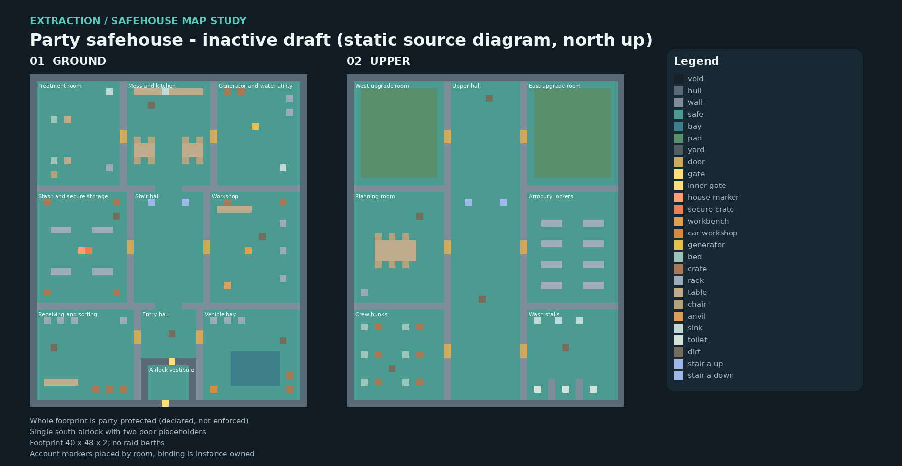

# Extraction party safehouse: standalone template draft

This is an **inactive map study** for the `safehouse` kind of the
[extraction instance contract](extraction-instance-contract.md). It is the
regular, non-train Extraction home: one party-owned building that is allocated
as a private home, never transported and never raided. The draft supplies
editable DMM output, a declarative layout manifest and the seven-field template
descriptor. It is not selectable, loads no player saves, changes no shared
extraction code and adds no allocator, teleporter or map-selection entry. The
geometry is original Civ13 work using existing turf, furniture and extraction
marker types; it is genre-inspired, not a copy of another game's hideout.



## Why a standalone template

The merged Extraction mode keeps sixteen fixed 9 x 9 private rooms on level 2
of each raid map, bound to the owner by a four-tile distance rule around the
house marker ([extraction-survival.md](extraction-survival.md#original-safe-house-hub-layout)).
The instance contract already validates `safehouse` records with one to four
decks and no berths, but no template existed to allocate. This draft is that
template: a bounded party building the future instance owner can reserve as a
whole z interval, instead of growing the per-raid room pool by hand.

## Layout

The footprint is a fixed **40 x 48 tile** rectangle over **two decks**, facing
north, with its only entrance in the south hull. One **128 x 128 x 2** staging
map holds two demonstration home slots; the western slot contains the
prototype and the eastern slot stays empty for static allocation checks. Both
slots share z1..2 and therefore cannot both be private homes in one runtime
registry; they demonstrate isolation and reuse, not a party cap.

| Deck | Rooms | Purpose |
| --- | --- | --- |
| Ground | Airlock vestibule, receiving and sorting, entry hall, vehicle bay, stash and secure storage, stair hall, workshop, treatment room, mess and kitchen, generator and water utility | Arrival, account storage, assembly, vehicle bay and field recovery |
| Upper | Crew bunks, upper hall, wash stalls, planning room, armoury lockers, two upgrade rooms | Rest, planning, gear lockers and two 11 x 13 clear upgrade pads |

The airlock is a 6 x 5 vestibule inside the south hull between two distinct
door placeholders: outer gate `(19,0)` on the hull line and inner gate `(20,6)`.
Closing either door statically separates the yard from the interior. Both
doors are ordinary locked doors and enforce no party check, interlock or
invulnerability. Two stair routes at `(17,29)` and `(22,29)` link the decks
through the central hall; their `area_id` pair labels are unique to this
prototype and describe geometry, not accepted runtime travel.

The stash room places the production account objects by room number:
`/obj/effect/extraction_house_marker` at `(7,22)`, the secure crate beside it
at `(8,22)`, the private tool workbench at `(31,22)` in the workshop and the
private automobile workshop at `(26,2)` beside a clear 7 x 5 vehicle bay.
Production binds the crate, workbench and bay within four tiles of the marker.
This template deliberately exceeds that radius; activation requires the
instance owner to bind those objects by instance identity. The interior floor
is `/turf/floor/plating/extraction_house`, whose entry check already refuses
mobs outside an owned Extraction session; in any other mode nothing can enter,
which is the intended fail-closed state for an inactive template.

Beds, lockers, racks, tables and the inert generator prop are prototype
furnishings. They decide no starter inventory, upgrade cost or crew cap.

## Protection and sustenance requirements

The whole footprint on both decks is the party-protected compartment. Every
hull, partition, door and stair tile is permanent structure that must deny
damage, deconstruction, forced entry, removal and replacement; high health
alone does not meet this requirement. Player-built upgrade contents are a
distinct category and do not inherit that invincibility. While an authorized
party member actually occupies the treatment room, mess or bunks, nutrition
and hydration must passively increase up to normal healthy caps instead of
draining. No rate is chosen; the mechanics owner applies it once per
metabolism update and resumes ordinary behaviour on exit. Safe egress after
membership changes or disconnect remains an unresolved policy decision. The
manifest records these as declarative requirements with
`enforced_by_this_map: false`.

## Files and coordinate contract

- `maps/WIP/extraction_safehouse.dmm`: generated map source, from
  `tests/safehouse_map/build_map.py`; edit the generator and regenerate.
- `maps/WIP/extraction_safehouse.layout.json`: versioned static layout data.
- `maps/WIP/extraction_safehouse.template.json`: instance ABI v1 descriptor.
- `tests/safehouse_map/validate_map.py`: DMM and layout validator.
- `tests/safehouse_map/test_layout.py`: static checks and mutation controls.
- `tests/safehouse_map/compile_map.py`: native compile-only harness.
- `tests/safehouse_map/preview.py`: source diagram export (needs Pillow).

Local coordinates start at the ground southwest tile `(0,0,0)`; world
coordinates are BYOND's one-based `(x,y,z)` and `world = slot.origin + local`.
Mask rows are ordered south to north. The descriptor exports exactly
`schema: 1`, `template_id: "safehouse_draft_v1"`, `revision: 1`, `width: 40`,
`height: 48`, two ordered decks (`ground`, `upper`) and `berths: []`.

| Slot ID | Ground world origin | Inclusive reservation |
| --- | --- | --- |
| `home_west` | (20,40,1) | x14..65, y34..93, z1..2 |
| `home_east` | (72,40,1) | x66..117, y34..93, z1..2 |

## Verification

```sh
python3 tests/safehouse_map/build_map.py --check
python3 tests/safehouse_map/validate_map.py
python3 -m unittest discover -s tests/safehouse_map -p "test_*.py" -v
python3 tests/safehouse_map/compile_map.py --byond-bin /path/to/byond/bin --evidence-dir /fresh/evidence/directory
```

The static checks cover encoded dimensions, literal DMM overrides, deterministic
output, hull closure with the airlock as the only opening, vestibule enclosure,
reachability of every room and anchor from the arrival tile across both decks,
clear vehicle bay, spines and upgrade pads, exact account marker placement,
empty demonstration slot, disjoint slot reservations and the declared protection
lists. Mutation controls must be rejected. The `safehouse_map` offline suite
runs `test_layout.py` under the existing CI suite selection. The compile
harness substitutes the draft for the marked production map-selection block in
a disposable DME, requires the pinned compiler with zero diagnostics, and
requires a generated missing-type DMM to fail with exactly its undefined-type
pair. None of this executes constructors, doors, party checks, saves or
allocation; native acceptance belongs to the future mechanics and persistence
owner together with the Dagger contracts in [dagger-train-map.md](dagger-train-map.md).
