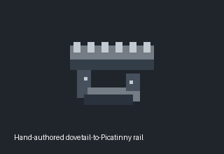

# Firearm maintenance and configuration

Unload the chamber and internal ammunition, remove the magazine even when empty,
and unload any attached grenade launcher before working. Hold the gun and keep the
part in the active hand. Work takes 15 ticks and cancels if access, compatibility,
tools or ammunition change. A gun under work cannot fire or reload.

Optics and optic rails require a screwdriver in your inventory. Underbarrel grips
and launchers require an adjacent anchored firearm maintenance bench. Compatible
bayonets and suppressors use hand installation. Use **Field Strip** to select a
part to remove; the same tool rules apply. Integrated iron sights stay installed.
Removed parts drop at your feet. Remove an optic before removing its adapter.

The dovetail-to-Picatinny rail adapter provides one physical optic interface on a
gun with a native dovetail scope mount and no native Picatinny mount. It needs an
empty optic slot. It accepts one Picatinny optic, stored inside the rail; it adds
no second optic slot and cannot host another adapter. It does not change caliber,
magazines, ammunition, suppressor fit or underbarrel mounts.

Craft the rail from **2 steel**, using the existing **Tools** crafting menu after
**Gunsmithing**, in eras **6 through 8**. Crafting takes **120 ticks**. The icon is
hand-authored pixel art; the preview below uses those exact sprite pixels.

Parts retain their existing ergonomics factors. Weight is the gun's baseline plus
the rail (0.15) and nonnegative part weights. Effective ergonomics are baseline
times the existing part factors, divided by `1 + added weight / max(1, base weight)`.
The existing firing dispersion calculation uses this ergonomics value. These are
game balance values, not real-world performance claims. Reassembly and load hooks
recompute from the saved baseline, preventing accumulated multiplication errors.

A cleaning kit works on projectile firearms other than bows from **50% condition
up to, but excluding, 80%**, restoring **80%** after 100 ticks. Worse damage needs
the firearm maintenance bench. The bench keeps its existing **25 condition** repair
and **1 maximum condition** cost, taking 180 ticks. Health must remain positive;
broken firearms are not resurrected. Damage during work cancels the repair.
Existing shot wear, jams and health checks continue to use native condition.

## Verification

`tests/gun_configuration/run.ps1 -ByondBin <516.1681-bin>` executes production
configuration, maintenance, firing dispersion and native save/load bodies in a
bounded temporary world. Startup, selected waits and inventory are fixture adapters;
the check does not establish human UI, live multiplayer or production crash behavior.
`-NegativeControl` omits completion ownership validation in a temporary source copy
and must be caught by the dropped-part regression. CI runs both checks on game changes.
The parts use gun-owned contents and bounded inventory scans, with no new timers.
