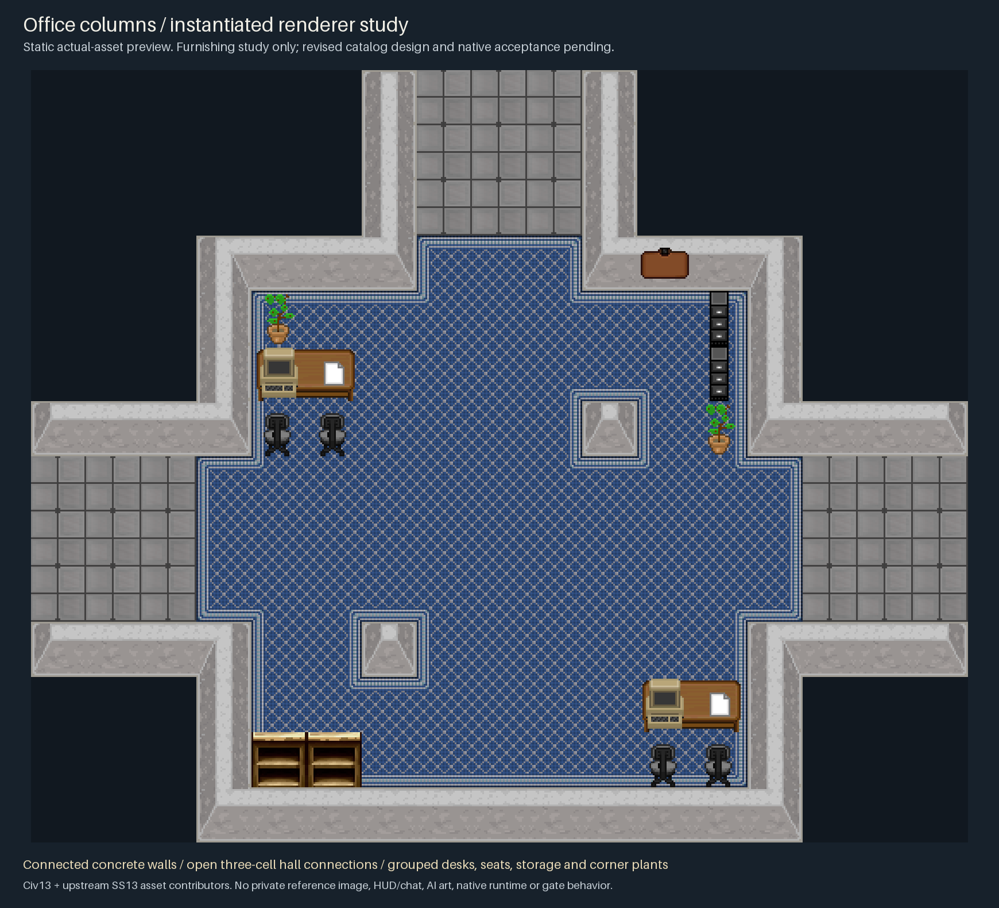
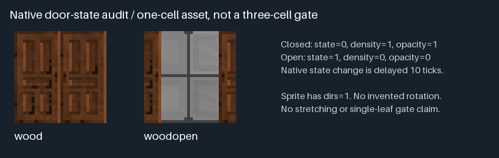

# Source-backed renderer fidelity study

This is one **static actual-asset renderer study**, not a revised room catalog,
accepted design, game screenshot or working mode. The [version-1 previews](ROOM-PREVIEWS.md)
were rejected as unconvincing room layouts; their files remain unchanged as
historical evidence. The design owner owns revised catalog geometry and actual
furnishing rules. This study isolates rendering corrections using the pinned
old `office_columns` family, with clearly separate illustrative furnishings.



## What changed in rendering

The old renderer repeated `cement_wall0` for every wall cell. In
`code/game/turfs/wall_icon_exp.dm`, `check_relatives` instead ORs the native
direction bits of compatible adjacent walls and selects
`cement_wall[junction]`. N=1, S=2, E=4 and W=8. The study uses the actual existing
states, including 3 for north/south runs, 12 for east/west runs, and the correct
corner/end junctions. State 0 remains appropriate only for the two isolated
authored columns. Concrete's `icon_colour` is null; no invented color tint is
applied. Native damage, cutaway, lighting and constructor parity remain untested.

All three existing declared W/E/N sockets are explicitly instantiated as
three-cell floor openings into visible hall stubs. The source mask and two X
columns remain pinned. These instance openings are recorded separately from the
sealed original mask in the [result manifest](renderer-fidelity-study/manifest.json).
The stubs provide wall/floor context, not an additional catalog or generated
chapter. There are no cyan entrance labels or collision colors in the scene.

The renderer also applies the source carpet edge/outer-corner/concave-corner
selection and actual DMI directions. It reads frame/direction counts instead of
always selecting the first directional frame. The visible carpet border now
follows the walls, columns and carpet-to-tile thresholds.

## Furniture has roles and orientation

The [semantic scene input](fidelity-study-scene.json) records each actual asset,
type candidate, position, direction and role. Two paired wooden work surfaces
use the source's end-table state with the direction toward their table neighbor.
Each dark office chair faces its north-adjacent desk. CRT terminals and papers
are placed on work surfaces. Filing cabinets are storage beside a wall, not
stand-ins for a partition or machine. Empty shelves and plastic plants occupy
peripheral space. The empty notice board is a wall fixture. No chairs, papers or
CRT screens are used as a substitute for a progression marker.

These are illustrative instance placements on the old mask, not proposed edits
to all rooms. The central crossing, three-wide socket approaches and original
(5,5) anchor stay clear. A conservative 3 x 3 footprint search with dense
furnishings treated as blocked connects the west, east and north hall centers
through that anchor. This does not prove native interaction distances, desk
usability for an oversized abstract actor, cabinet immutability or native
pathfinding. Revised room programs may choose different dimensions/reserves and
deliberately unfurnished rooms where the theme calls for them.

The source audit rejected the generic computer default `ibm_off`: its DMI does
not contain that state. The shown CRT uses `/obj/structure/telecom/terminal`
from `code/modules/1713/modern_terminal.dm`, which explicitly selects the
existing `ibm` state. It is a cable-network terminal appearance, not a functioning
power/network simulation or an AOTD OS94 computer. Era/equipment admission is
still separate. Empty office chairs use their existing base sprite;
`officechair_dark_over`, requested by the native constructor, is missing from
the DMI and is explicitly reported rather than synthesized.

## Native doorway state and width contract



For the existing `/obj/structure/simple_door`, the default wood material supplies
`basic_icon=wood` and color `#824B28`. The closed state is `wood`; the open state
is `woodopen`. `Open`/`Close` transition density, opacity and state after a
10-tick delay; `update_icon` selects the final frame. The audit image uses those
real states and the source tint. Both states declare `dirs=1`, so no directional
variants are invented. Animation is not simulated.

This is a one-tile native door asset. The authored openings are three tiles
wide. Stretching the art, placing a center leaf while leaving side bypasses, or
claiming one leaf controls a three-cell gate would hide an unsupported mapping.
The representative therefore uses real **ungated open passages**. A future
gated socket needs a separately reviewed full-width collision/state owner and
correct open/closed appearance. Door operation/locks are not proven by a swatch.

## Reproduce, verification and attribution

```powershell
& '<verified-python.exe>' docs/liminal/render_fidelity_study.py --output '<new-folder>'
```

Python 3.12.4/Pillow 10.4.0 produced these pixels. The bounded renderer supports
only this pinned room, explicit contextual halls, audited table-pair case and
existing DMI states. It emits no DMM, native mode or generator implementation.
Output destinations must be new. No BYOND/client/runtime or ports are used.

The scene and door audit were inspected as actual pixels. Connected wall
straight/corner/isolated controls, placed-prop roles, chairs facing desks,
surface items on desks, clear anchor and three-wide circulation reserve, and
radius-1 hall-to-hall reachability all passed. The manifest records source Git
blob/canonical hashes, every chosen DMI frame/direction/crop, every layer,
scene/renderer hashes and output hashes. Static checks do not establish native
appearance, functioning furnishings or design acceptance.

Existing Civ13/upstream SS13 art contributors retain attribution and the
[repository LICENSE](../../LICENSE). No source DMI is modified. Per-file original
authorship remains unspecified where the repository supplies no sidecar; no new
license determination is made. No external imagery, private reference pixels,
HUD/chat, conversation identifiers or AI-generated assets are included.
