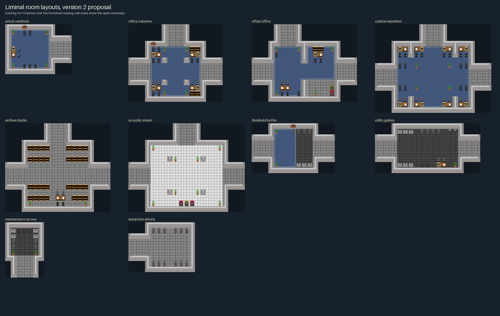

# Furnished room layouts (version 2 proposal)

**Status: accepted by Val on 2026-11-04.** This revises the ten room interiors
after the [version-1 previews](ROOM-PREVIEWS.md) were rejected as sparse and
unconvincing. The topology tool now uses the version-2 catalog. It is still not
native-approved.



Each room now has a purpose and is furnished for it, using existing Civ13
sprites only. Desks come in pairs with seats facing them, terminals and papers
sit on desks, storage stands against walls, and solid furniture never blocks
a doorway approach or an anchor. Doorways are shown open into short hall stubs.

| Room | Program |
| --- | --- |
| [Arrival vestibule](room-previews-v2/arrival_vestibule.png) | Reception lobby with a staffed desk, waiting chairs and plants; the spawn floor stays open |
| [Office columns](room-previews-v2/office_columns.png) | Open-plan office: four two-desk pods tucked behind columns around a clear crossing |
| [Offset office](room-previews-v2/offset_office.png) | Manager's suite: a partition splits a meeting table from executive desks and a break corner |
| [Cubicle repetition](room-previews-v2/cubicle_repetition.png) | Cubicle farm: eight desks in four divided bays, storage at the bay ends |
| [Archive stacks](room-previews-v2/archive_stacks.png) | Records archive: bookcase stacks with browsing aisles and a reading table |
| [Acoustic atrium](room-previews-v2/acoustic_atrium.png) | Tall tiled hall with planted columns and a vending bay |
| [Threshold buffer](room-previews-v2/threshold_buffer.png) | Changeover room where office carpet meets lockers, racks and service plating |
| [Utility gallery](room-previews-v2/utility_gallery.png) | Maintenance workshop with racks, lockers, sinks and a terminal workbench by the objective |
| [Maintenance alcove](room-previews-v2/maintenance_alcove.png) | Supply closet ringed with racks, cabinets and lockers |
| [Extraction airlock](room-previews-v2/extraction_airlock.png) | Egress airlock with suit-locker banks and a clear exit point |

## How it is built and checked

- [`room-layouts-v2.json`](room-layouts-v2.json) is the authored source: one
  ASCII layout per room (north row first) plus a floor-material grid.
- [`room_layouts_v2.py`](room_layouts_v2.py) derives
  [`room-archetypes-v2.json`](room-archetypes-v2.json) in the existing catalog
  schema. Solid furniture becomes `X` in the mask, so the topology tool's own
  `validate_catalog` checks socket bounds, anchor clearance and radius-1
  connectivity with the furniture in place.
- Each room keeps the same size, role, zone, sockets and anchors as version 1,
  so the chapter grammar and generator need no changes.
- [`render_room_layouts_v2.py`](render_room_layouts_v2.py) renders the
  previews and a [manifest](room-previews-v2/manifest.json) of the asset
  types, DMI states and file hashes it used.
- `tests/liminal_maps/test_layouts_v2.py` (run by `tests/liminal_maps/run.py`)
  checks that the catalog is current, that solid cells match the mask, that
  chairs face desks, and that a blocked doorway or a chair with no desk is
  rejected.

Regenerate after editing the layouts:

```sh
python3 docs/liminal/room_layouts_v2.py --write
python3 docs/liminal/render_room_layouts_v2.py --output <new folder>
```

## Not decided here

- Native export, lighting and sound, and how a three-tile doorway maps to
  native doors.
- Single-tile aisles, such as the archive's browsing aisles, are walkable for
  players but are not counted by the radius-1 clearance model.
