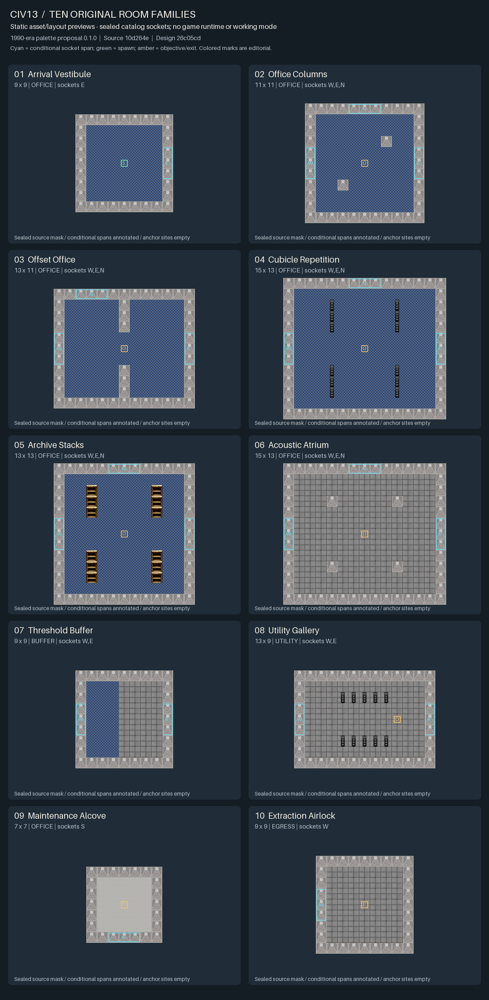

# Rejected historical asset-mask previews (version 1)

**Rejected as room-layout examples.** These images were judged visually
insufficient: isolated capped wall sprites, sealed labeled sockets and sparse
collision-mask presentation do not establish convincing room interiors. Preserve
the files and hashes as historical evidence only. They are not accepted design,
an approved palette, or a roadmap milestone. The [renderer fidelity study](RENDERER-FIDELITY-STUDY.md)
addresses the rendering defects separately while catalog redesign remains with
the design owner.

These are **static asset/layout previews**, not in-game screenshots, a working
mode, native appearance acceptance or an approved native palette. They composite
existing Civ13 DMI pixels over the exact original room masks from design commit
`26c05cd8f85821c3ce76dcc72e3f0e61378c7ac4`. Selected assets and type definitions
are unchanged from source baseline `10d264e5896221b34949ee4b67c0fd2b94bde249`.
No AI-generated art, third-party room imagery or external assets are included.



Open the [full contact sheet](room-previews-v1/contact-sheet.png) for readable
labels. Every individual PNG uses the same 64-pixel cell scale; the contact
sheet uses the original 32-pixel scale. North is up. Catalog coordinates are
zero-based with row zero south, so the raster reverses rows only.

| Family / individual PNG | Cells | Conditional sockets | Solid X cells | Radius-1 centers | Key layout check |
| --- | --- | --- | --- | --- | --- |
| [Arrival vestibule](room-previews-v1/arrival_vestibule.png) | 9 x 9 | E | 0 | 25 | Empty spawn (4,4), clear orientation volume |
| [Office columns](room-previews-v1/office_columns.png) | 11 x 11 | W,E,N | 2 | 31 | Two columns at authored opposing offsets |
| [Offset office](room-previews-v1/offset_office.png) | 13 x 11 | W,E,N | 6 | 45 | Two partition masses, three-cell central opening |
| [Cubicle repetition](room-previews-v1/cubicle_repetition.png) | 15 x 13 | W,E,N | 12 | 51 | Four repeated cabinet bays, central route clear |
| [Archive stacks](room-previews-v1/archive_stacks.png) | 13 x 13 | W,E,N | 12 | 33 | Four empty shelf banks, continuous central aisle |
| [Acoustic atrium](room-previews-v1/acoustic_atrium.png) | 15 x 13 | W,E,N | 4 | 63 | Open tiled volume, four isolated columns |
| [Threshold buffer](room-previews-v1/threshold_buffer.png) | 9 x 9 | W,E | 0 | 25 | Carpet/tile boundary, no added obstruction |
| [Utility gallery](room-previews-v1/utility_gallery.png) | 13 x 9 | W,E | 10 | 17 | Two five-cabinet banks, work site (9,4) empty |
| [Maintenance alcove](room-previews-v1/maintenance_alcove.png) | 7 x 7 | S | 0 | 9 | South detour mouth, discovery site (3,3) empty |
| [Extraction airlock](room-previews-v1/extraction_airlock.png) | 9 x 9 | W | 0 | 25 | West entrance location, terminal site (4,4) empty |

## Annotations and traversal evidence

Canonical masks seal every socket until a paired chapter link is admitted.
These images preserve those walls. Cyan rectangles identify the exact
three-cell conditional entrance spans; they are editorial overlays, not open
doors or working connections. Offset office's north socket stays at x=3;
the maintenance socket faces south. No aperture is widened, shifted or silently
opened for presentation.

Green S marks spawn. Amber O and E mark objective and exit sites. These are
annotations over empty authored floor, not added items, functional props or
native landmarks. No decoration, lights or consoles are placed on a floor cell.
Every # and X retains its full abstract blocking cell even where a chosen prop's
visible pixels occupy less than the whole tile.

The renderer checks row/column counts, original mask cells, socket wall cells,
the full three-cell-wide inward approach through depths 1-3, every anchor's
3 x 3 floor footprint, and connectivity of all radius-1 floor centers. The table
reports the sealed interior's center counts. This is authored reserve geometry,
not native pixel movement, progression or traversal through unpaired walls.

## Reusable palette proposal

The [palette source](preview-palette-v1.json),
`liminal-visual-proposal/0.1.0`, is `PROPOSAL_NOT_NATIVE_APPROVED`.
It records exact existing type candidates, literal vars, icon paths, states,
era rationale and unresolved roles. This is a review input for the indoor
generator's separately approved palette. No generator, DMM or native type is
implemented here.

The [manifest](room-previews-v1/manifest.json) binds revisions, canonical catalog
digest, source blob/file hashes, palette/renderer/reader hashes, Python/Pillow
versions, output hashes/dimensions, masks, anchors, sockets and reserved centers.
The [tile mapping](room-previews-v1/tile-mapping.json) enumerates every cell's
ordered asset layers. Geometry and catalog version remain unchanged.

The period proposal uses existing light-blue woven carpet, plain grey square
tile, concrete, mechanical filing cabinets and wooden bookcases. These ordinary
pre-1993 visual forms do not implement equipment, recipe or research filtering.
Threshold buffer's material split is a palette choice over unchanged floor.

Known native differences and unsupported mappings:

- Walls repeat existing `cement_wall0`. Native walls construct material overlays
  and select neighboring junction states; this does not reproduce that renderer.
- Carpet base tiles omit runtime edges/corners. Concrete uses a fixed frame;
  its constructor may randomize and declares `interior=FALSE`.
- Cubicle X cells use closed filing cabinets as a repeated-mass proposal.
  Dedicated fabric dividers are unmapped. Utility cabinets represent storage,
  not power machines or a functional service objective. Cabinets are mutable
  native objects; density is not permanent blocker/gate ownership.
- Archive uses empty `book-0`. Contents/era can change native graphics; no books,
  research stock or functional content is invented.
- Doors/locks, spawn admission, discovery/service handlers, extraction area,
  lights, sound/occlusion and portals are unmapped. Full-bright compositing
  supports pixel inspection only; light/audio acceptance stays pending.

## Reproduce and inspect

Python 3.12.4 and Pillow 10.4.0 produced the reviewed pixels, using Pillow's
bundled label font. The renderer reuses `tests/animal_harvest/preview.py` for DMI
extraction and rejects missing, transparent or non-32-pixel frames, changed
source assets/catalog and an existing output destination. It invokes no BYOND
tools and downloads nothing.

```powershell
# Use a verified real Python executable on Windows, not the Store alias.
& '<verified-python.exe>' docs/liminal/render_room_previews.py --output '<new-output-folder>'
```

All ten individual PNGs and the contact sheet were inspected as actual pixels.
Labels, dimensions, X counts, socket sides/offsets, anchors and distinctive
layouts match the authored catalog. Static audit checks passed for every room.
BYOND compilation, runtime and client checks were not run.

Existing Civ13 and upstream SS13 art contributors retain credit. No DMI source
was modified. First-frame extraction, alpha compositing and nearest-neighbor
scaling are the only asset operations. The [root LICENSE](../../LICENSE) contains
GNU AGPL v3; no per-file license sidecars were found for these five DMI resources.
The manifest retains that evidence and limitation without assigning unverified
individual authorship or declaring a new per-file license.
