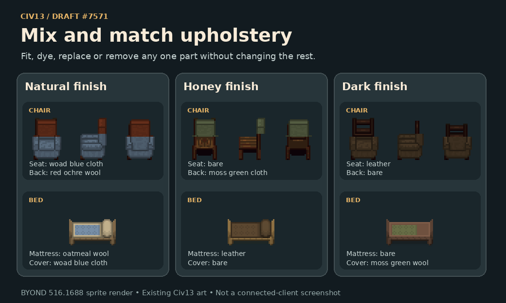

# Modular furniture (draft)

Choose, preview, cut and assemble furniture much like tailored clothing. The
first two frames are a wooden chair with a **seat and back**, and a wooden bed
with a **mattress and cover**. Every part can be left bare.

1. With **Basic Furniture**, craft a **furniture project** from four finished
   planks in the Furniture menu. Use it in hand to choose the frame and a
   natural, honey, or dark wood finish.
2. Hold a cloth, woolcloth, or leather sheet in your other hand and use it on
   the project. Pick the part to fit. Cloth and woolcloth can use the tailoring
   dyes you know; woolcloth takes dye at a softer tone. Leather keeps its own
   color. Each fitted part costs one sheet. Preview the parts together.
3. Use **Remove upholstery** to leave a part bare and recover its sheet before
   cutting. Confirm **Cut parts** to lock the design. Stand on clear, solid
   ground and **Assemble** to place the finished frame at your feet.
4. After assembly, use another sheet on unoccupied furniture to replace one
   part, or wirecutters to remove just that part. The frame, other part and
   wood finish stay in place. The removed part gives back one matching sheet,
   without retaining its dye. Dismantling recovers each fitted sheet once.

These are appearance and material choices, not comfort, health, temperature,
or armor bonuses. Existing recipes, ordinary furniture, wrench behavior and
sitting/sleeping remain intact. Placement on moving decks is excluded.

## Other furniture

- **Stools:** a single replaceable seat fits this model. Keep the existing
  portable stool and its legacy leather/cushion storage separate at first.
- **Benches:** seat and back are natural next parts. A bench needs its own
  directional masks; it should not inherit an armchair sprite or occupant layer.
- **Sectional sofas:** existing left, center, and right sections can eventually
  reuse the part records and transactions. Keep their current construction
  costs and avoid generating refunds from historically untracked fixed padding.
- **Curtains and wall hangings:** keep the current single-fabric interaction.
  Add a trim slot only once it has its own visible layer and paid input.

Review this draft by independently choosing both slots, saving/reloading,
replacing one while keeping the other, and checking that cancellation or a
stale request never consumes a sheet. The preview above was rendered with BYOND
from the game sprites; it is not a connected-client screenshot.
