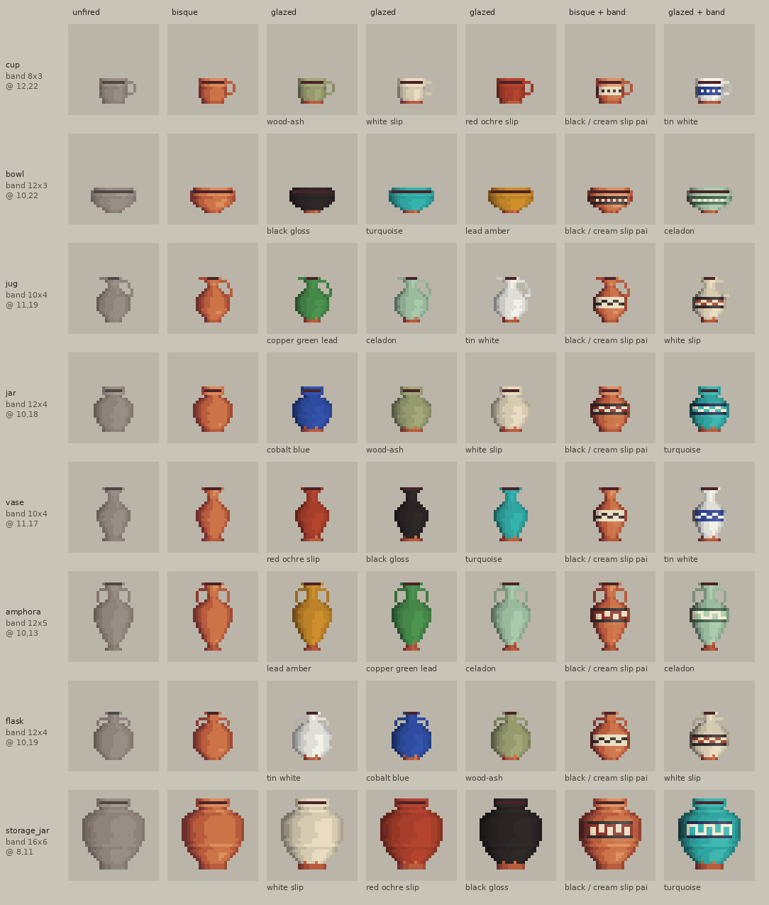

# Designed pottery

`code/modules/1713/pottery_design.dm`. Part of the homes and towns plan (phase 2).

- **Unfired clay vessel** (3 clay, hand recipe or the potter's wheel, Pottery & Storage).
  Use it in hand: Shape (cup, bowl, jug, jar, vase, amphora, pilgrim flask,
  storage jar), Paint band, Clear band, Glaze.
- **Band**: the painting editor opens at the band's own size (8x3 for a cup up
  to 16x6 for a storage jar). Carried pigments are the slips; the bisque
  colour `#c97b52` is left bare. Finishing puts the pixels on the vessel
  (`band_palette`, `band_data`, `band_by`); band canvases never count toward
  the region painting cap.
- **Glaze**: white and red ochre slip for anyone; black gloss and wood-ash
  with Pottery & Storage; turquoise, amber and green lead glazes with
  Glassworking; celadon, tin white and cobalt blue with Fine Arts.
- **Firing**: the oven calls `/obj/item/weapon/clay/proc/fired_result(where)`;
  the vessel returns `/obj/item/weapon/reagent_containers/food/drinks/clay/designed`
  with the design, a working container sized by shape (30 to 200 units).
- **Art**: a glazed or banded pot set down (not carried) counts in
  `mood_is_art`, so it lifts mood nearby and gives a home its art category.

Sprites: Fable, `icons/obj/pottery_designs.dmi` (`<shape>_unfired`, `<shape>`,
`<shape>_glaze` tinted by the glaze colour, `<shape>_shade`), generator
`tests/sprites/create_pottery_designs.py`.

Test: `python3 tests/ecology_spawning/run_linux.py . tests/pottery_design/probe.dm`.
