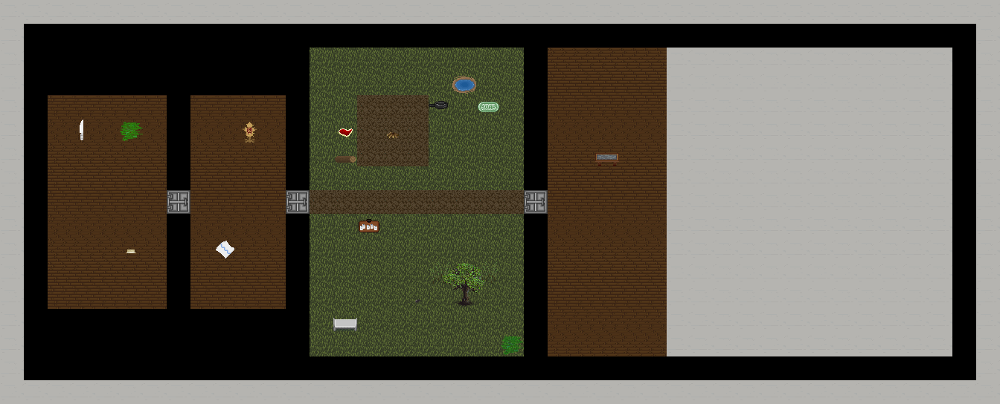

# Practice rooms

A lobby link, **Practice Room**, puts a player in a private room (17 x 12 for the fallback on other regions) with a
throwaway "Trainee" body. Nineteen steps appear in chat one at a time. The
controls part: walk to a marker, pick up a knife, swap hands, wear a straw hat
and open a door. The middle part: hit a practice dummy on Harm intent and
bandage a small cut. The camp, behind a second door after switching back to
Help intent, covers the first day: fuel and light a campfire, roast raw meat
and eat it, fill a pot at a puddle, boil it on the fire and drink it, wash the
flea-ridden shirt at the puddle, wash with soap while undressed, dress again,
lie down in a bed, and walk onto the exit. The practice campfire never burns
away, cooks in five seconds and starts a new cycle whenever something is put on
it; the practice puddle neither refills nor breeds mosquitoes. A practice body
that catches an illness (fleas) is cured on the next step check. Finishing, dying or disconnecting returns the player to the
lobby. To leave early: the "click here to leave" link on the welcome line and
every step, **Leave practice room** in the Esc menu, clicking the blue exit
marker (asks first unless it is the last step), or the **Leave Practice Room**
verb, which heads the IC tab's Practice group with **Practice Instructions**
(repeats the current step).

Design reference: CM-SS13's tutorial rooms (`code/datums/tutorial/`, AGPL-3.0).
This is a reimplementation; no CM code or art is copied.

## Where the rooms live

Rooms are built on one level appended above the world (`world_z_budget`
purpose `practice`) only while someone practises:

- Up to 8 rooms, 14 tiles apart, on a plane of at most 175,000 cells (Gaia's
  500 x 350). Adding a Gaia-sized open-air plane measured 0.3 s and 20 MiB.
- The level is never saved. `begin_persistence_operation` closes every room
  and removes the level before a save; the level is removed as soon as the last player leaves, and every room is rebuilt with fresh turfs when it opens.
- While it exists `world_z_budget` refuses every other new level, so it stays
  `world.maxz` and can be removed whole. Multi-z links, observer spawn,
  landers and the ecology index skip it.
- Maps with instance/safehouse reservations and orbit worlds do not offer it.
- The body has `should_save = FALSE` and never records a persistence owner, so a
  player's saved character is untouched. The room area is an admin-area subtype,
  which keeps the body out of battle reports and spawn picks.

## Tutorial region

A region group can run the rooms on a world of their own, like the TDM
Barracks: a region of kind `TUTORIAL` on the blank map
`maps/special/tutorial.dmm` (253 x 69, up to 24 occupied rooms). Code:
`code/modules/1713/tutorial_region.dm`.

- It never saves: `shard_group.py` gives it `save_minutes` 0 and a config with
  `ALLOWED_GAMEMODES ALL` and `SKIP_PERSISTENCE_SAVING`, whatever the group or an
  overlay says, and `begin_persistence_operation` refuses a save there. The
  host's stop does not ask a non-saving world to save.
- It starts its round on its own with no countdown. Every arrival goes straight
  into a room; Join only points back. Leaving a room sends the player to the
  group's gate (which forwards them to their home land) or, without a relay, to
  the mainland.
- On every other region the lobby's **Practice Room** link sends the player
  there when the tutorial region is up or can be woken, and opens a room on its
  own world otherwise (or when waking fails).
- Nobody has a home there, trails and orbital batteries skip it, and it can be
  neither the mainland nor the gate. A group has at most one.
- It stays available while the lands are down (Val, 2026-11-21): like the
  gateway it never sleeps, a crash brings it back on the build it has, and an
  update reaches it by a plain restart on its own port once it is empty (never a
  standby handover).
- A gateway (scripts/shard-group/README.md, "Gateway world") offers the rooms to
  a player whose land cannot be reached yet, and leaving them brings the player
  back to the gateway, which sends them on again. The gateway never opens rooms
  of its own.

### The tutorial region's room

The dedicated Tutorial region builds a larger room than the 17 x 12 fallback
(`build_tutorial_room`, 40 x 15). The same nineteen steps run west to east
through four spaces joined by doors on one line:

1. **Controls room** and 2. **training room**, both wooden.
3. **Camp**, open grass with a dirt path between its two doors. Fire, food,
   water and the wash place are north of the path. The bed, the lesson board,
   a tree, tall grass and flint are south of it, and the blue exit marker
   stands in the south-east corner, away from the path.
4. **Workshop hall**, through the door at the east end of the path: a wooden
   drawing office with the workshop desk and the supplies, and a concrete
   building bay.

A source render of one built room (walls draw black; the two green glows are
the walk marker and the exit marker). [The hall fitted out for each built
exercise](images/practice-rooms/tutorial-room-exercises.png): empty, press,
airship yard, train, ship and house, top to bottom.

### Workshop and extra lessons

The workshop desk sets up one exercise in the trainee's private hall and lays
blank draughts, a pencil and that exercise's materials on the office floor
south of the desk. Use the ordinary designer, check the drawing, and save it
to the sheet. To try a different lesson or get fresh stock, leave and open a
new room.

- **Build here:** cars, tanks and planes use a stocked press in the south of
  the hall and airships a stocked yard; both build on the bay to their
  northeast, which holds the largest airship a sheet can (12 x 12). Trains use
  the stocked rail works and twelve tiles of straight track along the north of
  the bay (choose west-facing). A short railway exercise supplies sleepers,
  rails and a hammer to lay track over your plan's pegs. A ground-floor house
  exercise supplies wood, planks, stone and a hammer for floors, walls and
  doors (not roofs or upper levels). A small single-deck ship uses the slipway
  at the south wall and four kinds of loose material; keep its drawing at most
  five tiles wide and five long. It launches north into a pool, not on a
  voyage. The rocket works fabricates the pieces; the bay does not stack, fuel
  or launch a rocket.
- **Design here:** submarine, harbor, waterworks, contraption and space
  station. These lessons use the actual designers, but do not provision the
  matching physical construction site.
- **Lesson board** (in the camp): all in-game character tutorial topics
  (including the HUD, Crafting Atlas, book research, chat and Help) can be
  reread here. The camp's tree, tall grass and flint serve the branch, twine
  and whittling lessons. Book research is explained rather than enabled.

Workshop supplies and builds disappear with the room. Nothing carries over
to a real character or contributes to its tutorial progress. Workshop power
and construction access belong to the fixed practice fixtures; nothing is
unlocked in the live game.

Add one to a group config like any region, for example
`{"id": "tutorial", "name": "Tutorial", "kind": "TUTORIAL", "port": 1760, "transfer_port": 1770, "map": "maps/special/tutorial.dmm"}`
(`transfer_port` only when the group's other regions have one), then run
`setup --region tutorial` and `start --region tutorial`.

Tests: [tests/practice_rooms](../tests/practice_rooms/README.md).
