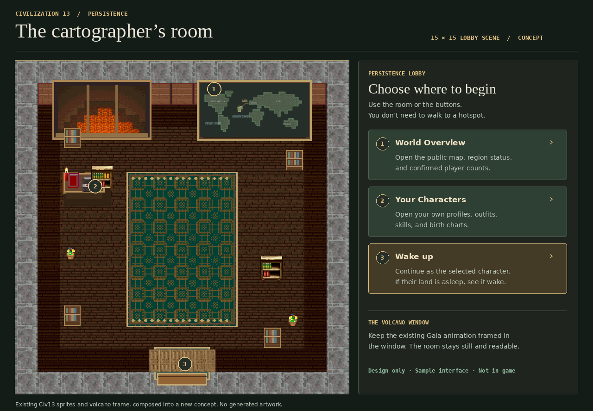
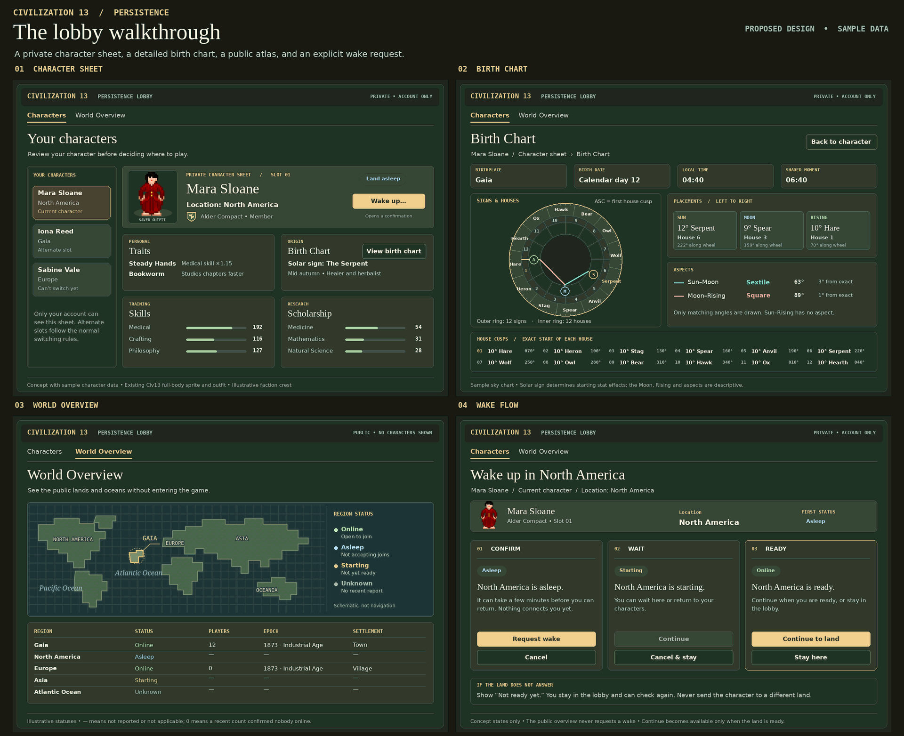

# Persistence lobby and sky charts: visual review

These mockups use illustrative accounts and region states, existing Civ13
sprites, and hand-composed interface artwork. They are not live screenshots.
The proposed style is a starting point for layout and art review, not a
constraint on the final UI. No generated artwork was used.

## 1. Cartographer's room (15×15 lobby)

[Open full-size room mockup](cartographers-room.png)

**Proposed:** The atlas opens **World Overview**, the desk opens **Your
Characters**, and the door continues as the selected character. All three
actions also have ordinary buttons; no movement or hotspot hunting is required.
Keep the existing Gaia volcano animation in the window rather than using it
as the whole screen. The draft does not replace the existing lobby scene.

## 2. Player flow at a glance

[Open the four-screen walkthrough](lobby-walkthrough.png)

| View | Full-size mockup | Code and remaining design work |
| --- | --- | --- |
| Private character sheet | [Character sheet](character-sheet.png) | [#7013](https://github.com/Civ13/Civ13/pull/7013) drafts a private picker, owned local bodies' basic stats, and active-character routing. The saved outfit portrait, faction emblem, expanded profile and Birth Chart link are proposed layout and data additions. If the sheet shows saved data for an asleep region, label it with its save time. |
| Birth Chart | [Birth chart wheel and all 12 cusps](birth-chart.png) | [#7018](https://github.com/Civ13/Civ13/pull/7018) drafts **IC → Birth Chart**, with recorded date, time and place, signs and houses, Sun/Moon/Rising, and aspects. The mockup shows a proposed presentation and private lobby entry; the gateway currently does not store or serve birth records. Unknown historical input stays **Not recorded**. |
| Star Chart and Astrology | [Side-by-side sky comparison](star-chart-and-astrology.png) | [#7022](https://github.com/Civ13/Civ13/pull/7022) drafts **IC → Star Chart**: a fictional current sky, upcoming sign changes, and comparison against fixed natal points. The layout shown here is illustrative. Neither view adds gameplay effects. |
| Public World Overview | [Atlas and region table](world-overview.png) | [#7015](https://github.com/Civ13/Civ13/pull/7015) drafts a read-only region table and schematic pins with cached public summaries. Named coastlines and the new composition are proposals. No names, character locations, birth data, or hidden regions; viewing never requests a wake. |
| Region wake | [Asleep, starting, and ready states](region-wake.png) | The draft gateway has routing behavior; this full live status panel is a proposal. **Gaia** can normally continue directly. Show a different land's actual state after a wake request, and show load phases only when confirmed. If it can't start, say so and show retry when appropriate; never present guessed progress or imply cancellation stops an already accepted region start. |

## What to review

1. Layout and art: room composition, actual art palette, how the hot spots read,
   and what each screen does at both narrow and wide lobby sizes.
2. Player copy: **Location** and **Wake up** should be direct. Separate the
   state of a land from a restriction on switching characters.
3. Keep the detailed birth chart useful without crowding the character summary.
   Plain sign labels, exact angles, cusp details, and a textual aspect legend
   should still work without artwork or color.
4. Privacy: keep character details private and the atlas public. Opening a
   sheet or atlas must not wake a land; a separate explicit action does.

No lobby art, runtime code, gameplay or production configuration is changed by
this review package.
