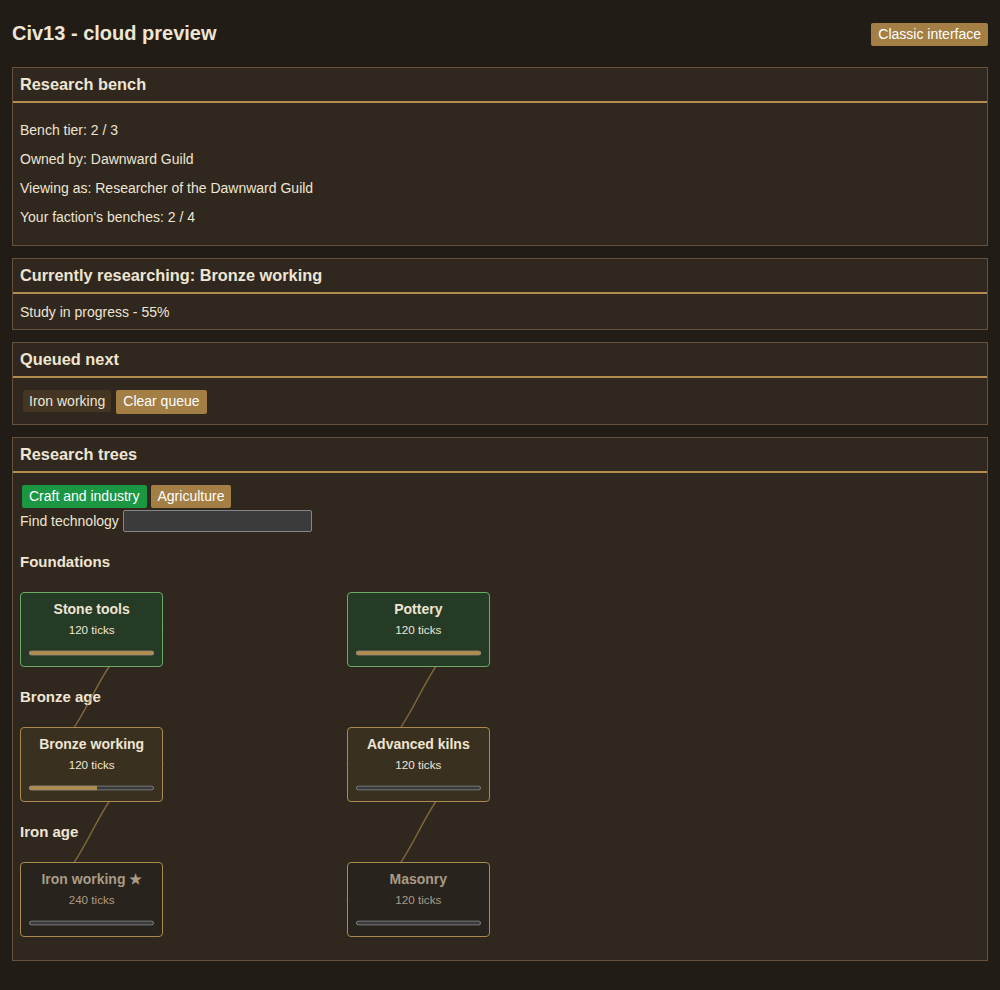
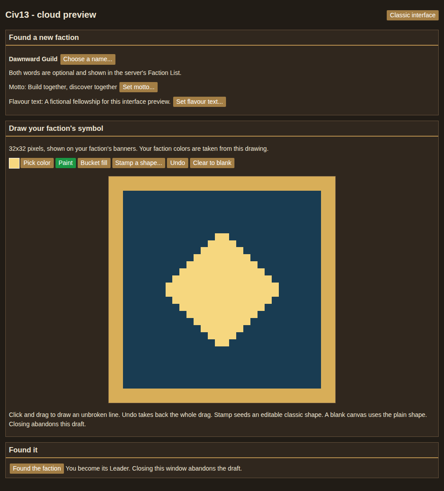
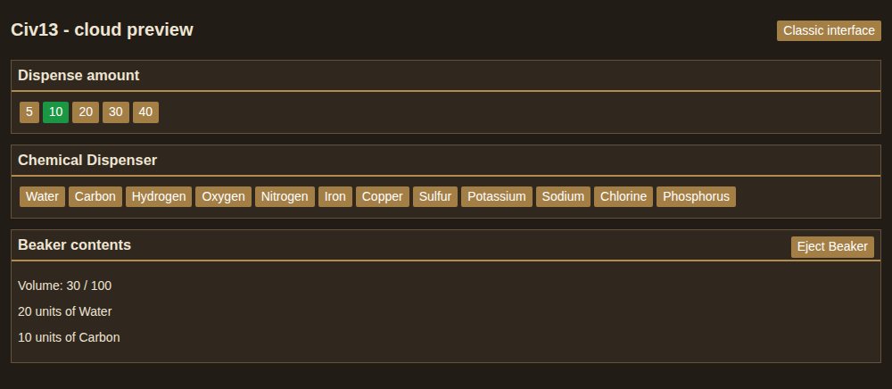
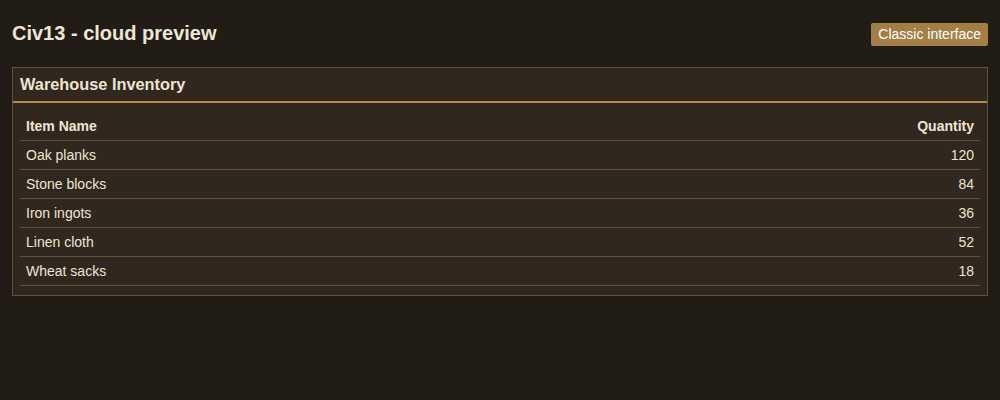

# Cloud UI previews

Actual production-bundle screenshots, captured on 2026-10-30 by hosted Chrome
156.0.8078.47 with Playwright, using deterministic fictional fixtures. These are
cloud browser previews, not native BYOND/OpenDream gameplay verification. No real
player or server data is used. No generated artwork or retouching is involved.

Source: `9bc71d86c38a1560bd3c23e80acacd7ba6a1c282`.
[Capture run](https://github.com/Civ13/Civ13/actions/runs/41096145774), artifact
`12995562935`. The production JS/CSS are unchanged from implementation commit
`c81253581ad9c7041ec7720c935c92e7d6b2edd5`.

Device scale factor: 1. Viewports are sized to the full application content
(the production UI scrolls inside the body), without CSS overrides:

| Screen | Viewport | Scenario |
| --- | --- | --- |
| Research | 1000 x 990 | Fictional guild, research queue, progress and prerequisites |
| Faction | 1000 x 1107 | Fictional founding draft and editable 32 x 32 emblem |
| Chemistry | 1000 x 436 | Dispensing controls and a partially filled beaker |
| Warehouse | 1000 x 400 | Fictional inventory and quantities |

See [provenance.json](provenance.json) for browser, head, viewport and full fixture
inputs. Reproduce with Node 24: `npm ci --ignore-scripts --prefix tgui`,
`npm --prefix tgui run build`, then
`CHROMIUM_PATH=/path/to/chrome PREVIEW_SOURCE_HEAD=$(git rev-parse HEAD) node tgui/scripts/screenshots.mjs`.
No browser download or game server is started. CI captures these as artifacts;
the committed gallery is updated only after visual inspection.

## Research

## Faction creation

## Chemistry

## Warehouse

