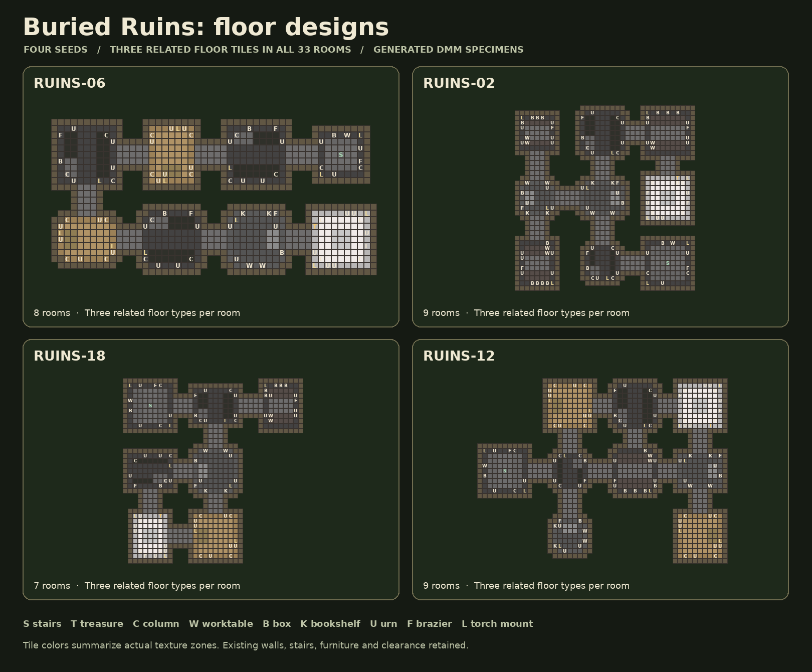

# Matching floor families

Use three existing Civ13 floors that look like they belong in the same room:
a broad main surface, a perimeter or circulation strip, and a restrained
accent. This replaces the more visually mixed
[five-style study](FLOOR_PATTERNS.md) as the current visual proposal. The
differences should read as changes in stone dressing, paving direction or
finish within a room, with the larger palette changes between rooms.

| Room | Main floor | Perimeter or circulation | Accent |
| --- | --- | --- | --- |
| Arrival guardroom | Running-bond gray cobble | Dark cobble edge | Cross-grain gray cobble aisle |
| Processional hall | Gold sandstone slabs | Gold sandstone brick perimeter | Inlaid sandstone dais |
| Collapsed watchpost | Mossy old stone | Dark cobble crossing | Running cobble repair |
| Supply storeroom | Rough gray setts | Dark cobble rim | Gray cobble cart aisle |
| Scribe workshop | Cut gray slate | Gray stone brick | Carved stone strip |
| Reliquary vault | Pale marble field | Pale marble grid surround | Ornate pale marble inset |

All **33 rooms** across the same four seeds show **exactly three** native
floor styles each, even after removing every fixture footprint from the
count. Each style contributes at least three connected exposed cells.
The [palette](cohesive/palette.json) records the 14 stock type paths, source
declarations and DMI states and the allowed materials per room. The
[exact floor codes](cohesive/exact-floor-codes.json) record every walkable
tile, room and zone counts, and matching DMM and manifest hashes.

The [offline receipt](cohesive/validation.json) covers parsed DMM output and
the preserved route constraints. A separate DMM readback independently
rejected mixed-family three-style sets and duplicate decorative covers.
Wall and fixture types and positions, corridor floor surfaces, entrances
and room geometry are unchanged. The 3 × 3 return routes remain 91, 65,
52 and 52 steps across the four seeds; each treasure/cache still has a
reachable cardinal approach. This revises the visual surface, not the
underlying room shapes or complexity. Both the overview and separate
room-sprite sheet are offline previews, not client captures. Native
appearance, lighting and gameplay have not been checked.
