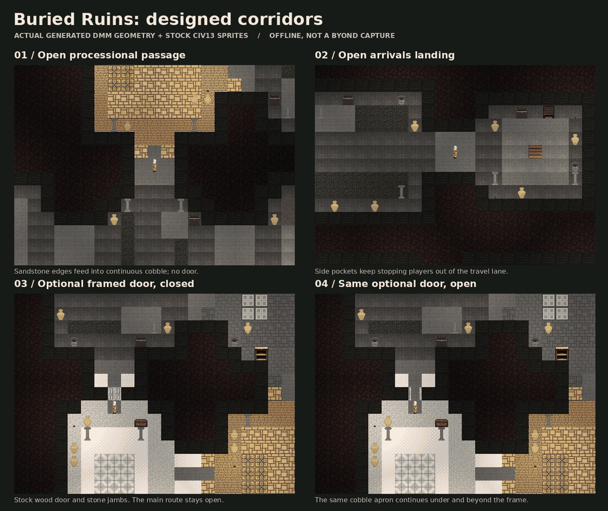

# Corridors with and without doors

A room's paving should not end at a hard tile seam. In this pass, each
corridor has a neutral running-cobble spine, the neighboring rooms'
matching stone finishes continue as curb strips, and the same floor
continues under each optional door and onto both of its approaches.
Doorless routes keep the whole three-tile cross section and retain the
earlier widened landing pockets where the map had room for them.

The four generated specimens use **32** designed corridors: 29 without a
door and three with an actual stock wood door. A doorway is one passable
tile when open, framed by two actual old-stone wall turfs. This makes it a
narrow optional route, not a three-tile opening or a painted doorway.
The door has no custom lock, trigger or map override. The preview shows the
expected closed and open sprites; it does not pretend to trigger a door in
BYOND. Stock door art is single-direction in its DMI, so passage axis here
describes the architecture, not a new door sprite rotation.

| Seed | Open passages | Optional doors | What opening the door changes | 3 × 3 main return with all doors closed |
| --- | ---: | ---: | --- | ---: |
| ruins-06 | 7 | 0 | No door | 91 steps |
| ruins-02 | 7 | 1 | Opens a side room and its optional cache approach | 65 steps |
| ruins-18 | 6 | 1 | Shortens the walk between the two door aprons from 44 steps to 2 | 52 steps |
| ruins-12 | 9 | 1 | Opens a side room | 52 steps |

All four arrival-to-vault routes remain reversible even with every door
closed. The two stone jambs remain solid even when the leaf is open, so
a one-tile side doorway is never treated as three-tile travel. With doors
open, all 33 rooms and all seven treasure/cache approach positions are
reachable on foot. The room interiors still use their
[three matching finishes](COHESIVE_FLOORS.md); room fixtures and the
outer map dimensions are unchanged. The only floor cells removed are
the six recorded jambs.

The [exact offline receipt](corridors/exact-corridor-receipt.json) records
the parsed tiles, leaf and jamb coordinates, DMM/manifest hashes and
independent closed/open reachability. Removing a jamb or a leaf from
each door-bearing specimen was rejected. Reachability treats a closed
leaf as blocking and an open one as clear based on the
[stock collision and opening code](../../code/game/objects/structures/door.dm#L192-L258).
It does not simulate a character performing the interaction.

A staged native check should verify that the mapped wood door really
starts closed, opens by ordinary interaction from either apron after
its normal delay, shows the right icon and sight line, blocks a player
when closed and allows a normal-footprint player to cross when open.
It should also cover another player nearby during the interaction, safe
return by the wide route while the shortcut is closed, and the saved
open/closed appearance after reload. No native run, production map
registration, transfer or expedition activation was done here.
