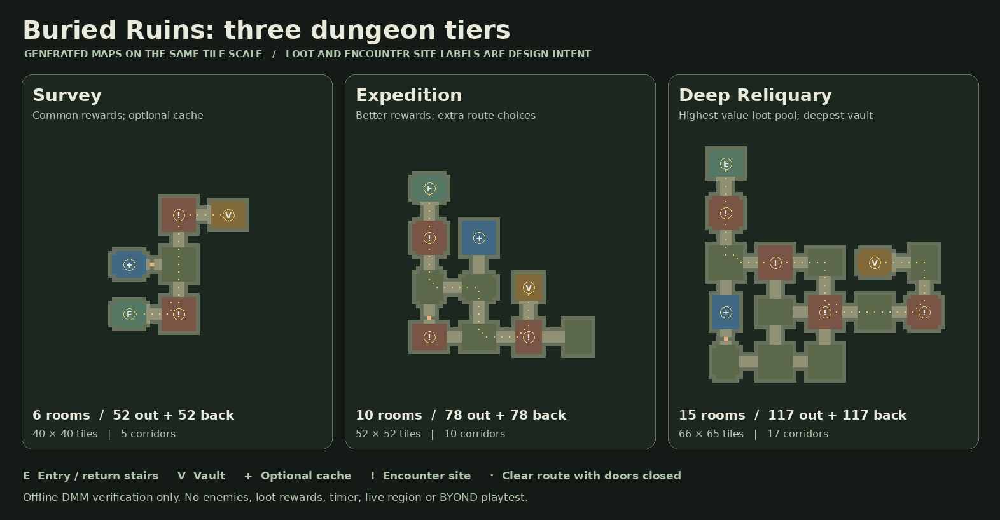

# Expedition tiers

Offer three clearly different expedition sizes. Tell players the difficulty,
time limit and reward band before the entire party readies up. It should take
more than a longer walk to earn better loot. These are disabled design profiles,
not new live tiers, tested combat encounters or tuned drop rates.

| Expedition | Rooms / loops | One-way clear main route | What makes it harder | Ready-to-exit deadline |
| --- | ---: | ---: | --- | ---: |
| **Survey** | 5–7 / 0–1 | 40–65 steps | A short obvious route, at least one optional branch, one required pressure beat at most | 12 min |
| **Expedition** | 8–11 / 1–2 | 66–95 steps | Crossing routes around several distinct rooms; at least two side rooms with a limited detour/shortcut choice; up to two required pressure beats | 20 min |
| **Deep Reliquary** | 12–16 / 2–3 | 96–140 steps | Several distinct wings and interconnected loops, at least four optional rooms, the furthest cache behind an extra voluntary challenge; up to three required pressure beats | 30 min |

A pressure beat is a bounded room-scale active challenge, not extra walking.
Use only an approved encounter or environmental-interaction template with
clear before/after tells and a retreat. On a short run a single exposed approach
plus one optional detour is enough. The middle tier places a decision at a
junction, with a safer longer route or an unlocked shortcut. The largest tier
uses separate wings, several clearly different room challenges, and a
well-signposted optional commitment for the second cache. Stronger patterns
may have different timing windows or less idle space; do not just add HP,
inflate damage, lengthen dead hallways, pile enemies at the entrance,
or copy an identical room encounter. Re-entry, deaths and server resets cannot
spawn extra rewarded encounters.

Require one continuous, always-retreatable 3 × 3 primary path independently
verified in both directions with all optional doors closed, a quiet arrival
area and an exit accessible from inside with neither loot nor a key. A
voluntary one-tile shortcut or side cache cannot block the wide route.
Opening a side door must not trap a party or remove return access when the
timer ends. Rooms intended for a group to wait or regroup must be distinct
from congestion at the exit. A failed layout rejects the profile before
admission rather than shrinking it or rolling another tier. The timer
begins only after all players are ready and the durable admission commits,
not on discovery, generation, or waiting in the lobby. The one-plane caps are
1,800/2,800/4,500 grid cells; measured native budget and launch admission may
be stricter. Do not add Gaia z-levels. Preserve normal solo/ready-party rules,
suggest up to four players in a lease, and cap at one active expedition per
origin region within global capacity; no multiplication of rewards per player.
Tier scheduling costs 1/2/3 lease budget units, not a player charge or
entitlement. None of these initial caps has been calibrated in gameplay.

## Verified map specimens

| Example | Footprint | Rooms / loops / off-route rooms | Out and back with doors closed | Marked pressure sites |
| --- | ---: | ---: | ---: | ---: |
| Survey, small-003 | 40 × 40 | 6 / 0 / 1 | 52 + 52 steps | 2 |
| Expedition, medium-002 | 52 × 52 | 10 / 1 / 3 | 78 + 78 steps | 3 |
| Deep Reliquary, large-012 | 66 × 65 | 15 / 3 / 5 | 117 + 117 steps | 4 |

These are actual, deterministic stock-tile DMM specimens, not a random seed
distribution or active game maps. They preserve the three exposed floor
styles per room and optional stock doors. Independent graph and DMM readback
used cardinal walking with a 3 × 3 clear footprint, modeled closed and open
door obstruction separately, confirmed adjacent treasure/cache access and
rejected a deliberately blocked start in all three specimens. The
[receipt](tiers/dmm-receipt.json) identifies the DMM and manifest for each
generated map by hash. Pressure sites are labels, not loaded hazards or
enemies. The three specimens mark one optional cache each; the large tier's
premium cache and its extra challenge remain proposed, not generated or
playtested. No loot, leases, timing, combat or native client was run.

## Bigger rewards without a research shortcut

Keep the [ten epoch tables](LOOT_BY_EPOCH.md) as a separate axis controlling
which items exist. In each epoch its first vault option is considered
featured for the initial balance proposal and the second ordinary. Keep the
same ordinary/research cap and transfer allowlist in every tier. Example:
a 1713 Survey vault offers the thermometer body, Expedition can draw the
compass, and Deep features the compass plus one eligible construction
supply unit. A modern phone never comes out of a 1713 map. Tools only
arrive in ordinary supported condition, without extra power or contents.
The epoch prize ordering is a design choice, not a measured market value.

| Tier | Supply / ordinary cache max | Extra cache | Vault | Whole-party cap |
| --- | --- | --- | --- | ---: |
| Survey | 2 / 1 units | None | One ordinary prize only | 4 units |
| Expedition | 3 / 2 units | None | One prize: 60% featured / 40% ordinary | 6 units |
| Deep Reliquary | 4 / 2 units | One off-route premium cache, max 2 eligible ordinary units | Guaranteed featured selection plus one eligible support unit on a clean, qualified clear | 10 units |

The Deep reward bundle and the premium cache opportunity are exclusive to
Deep; smaller routes may still award a normal example of the same featured
tool on a lucky middle-tier clear. Deep gets one extra eligible unit in
the supply slot, not double the piles. Its premium-cache draw uses the
same ordinary epoch cache pool with a different immutable slot ID and no
second rare tool. Its one vault support unit is of a normally allowed
material from that epoch's first supply row, not a new item family, and
has its own reserved one-use award subslot. It is granted only with a
qualified featured-vault selection, never as consolation for a dropped
or ineligible reward. The whole run always has **one** durable prize
maximum. Each slot, even when a fallback is used, counts against its cap.
Early exit can extract only the unlocked portions that were actually
obtained in supported custody. Failures and deaths pay no consolation
loot.

For comparison only, count each ordinary support unit as 1, an ordinary
durable prize as 3 and a featured one as 5. Under complete, fully eligible
clears the enumerated expected scores are 6.0 / 8.9–9.2 / 13.7–14.0 across
the ten epoch tables. This is proof of increasing proposed allocation
under those assumptions, not proof of economic value, realized extraction
or time-adjusted efficiency. A player with restricted ordinary eligibility
may receive less or none; a missed cache never pays. Tune with optional
encounter completion, retrieval, per-epoch value, failed runs and payouts
per hour measured separately. A large map should not become the best
raw-material farm. Apply account/party issuance limits in addition to bounded
origin leases; don't widen world ceilings or refill budget after failure.
Adjust future profile versions, not the reward promised by an issued map.

## Authority and verification

Extend the immutable original blueprint with tier ID, topology and pressure
profile version/hash, epoch table version/hash, admission class, reward
schedule and budget. Choose that tier when the authoritative map is issued,
never by renaming, recopying, attaching another chart, editing a client
parameter or failing a dig. The party can inspect and decline, not upgrade
a map. A deliberate eligible issuance may mint a new original with a new
server-selected seed and policy receipt; it never mints for a failed dig or
extraction. End a retired/unavailable profile without substitution or return
the intact original before durable excavation commitment. No rerolls on
reload, repeated opening, character changes, disconnects, or retries.
Reward reach and escrow continue to obey the [existing extraction design](README.md).
No stock door, regional transfer, lease, loot source or combat logic is
activated by [the review profiles](tier-profiles.json).

Validate the configured room counts, independent branch paths, mandatory
return distances, exit reachability under closed doors, and dimensions before
staging. Reject a tier from a bad ID, graph padded with duplicate leaf rooms,
optional door blocking the only retreat, out-of-epoch item or over-budget
award. On the bounded native acceptance fixture later exercise the same
approved encounters at real tick rate and with solo/full parties, check
timer/wait and escape, prove no repeated damage or duplicate award across
save/restart, and measure memory and loss-adjusted rewards.
