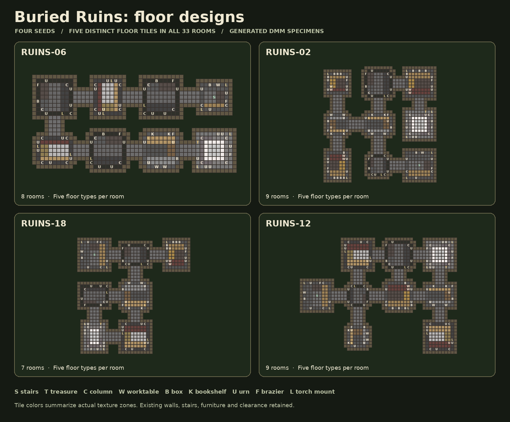

# Themed floor patterns

This five-style version is a comparison baseline. The current review uses
[three matching floor materials per room](COHESIVE_FLOORS.md).

The furnished stage established what rooms are for, where supports and objects
fit, and which areas should stay clear. This pass addresses a different issue:
the floors themselves should help a player recognize each room. It uses stock
Civ13 tile types and sprites rather than flat colors or random dots.

Floor patterns should be read as courses, borders, panels, dais and wear areas.
They are intentional decoration and visual orientation; the existing clear
return lane and interaction approaches remain gameplay constraints. Number of
styles alone is not a visual-quality metric.

This is a surface-treatment pass: silhouette, room adjacency, corridors, fixture
positions, staging space and encounter rules are not changed. A later layout
pass can vary room shapes, level views or route decisions; floor variety does
not make the existing lattice or corridor geometry more complex by itself.

All **33 rooms** across the same four seeds use **five** existing floor
styles; before, only four rooms used three or more. Each style is still
visible in at least three cells after excluding furniture, supports, stairs
and other fixtures. The full floor pattern has no disconnected one-tile
speckles; each style has at least one connected run of three or more tiles.

| Room | Thematic treatment |
| --- | --- |
| Arrival guardroom | Slate rim, sandstone threshold, separate guard/assembly wings and gear-up aisle |
| Processional hall | Sandstone support bands around a marble spine and inlaid dais |
| Collapsed watchpost | Mossy stone, dark paving and a repaired corner around a clear crossing |
| Supply storeroom | Slate perimeter, red crate bay, paved supply bay, cart aisle and loading apron |
| Scribe workshop | Carved workbench strip, shelving bay and red-inlay entrance |
| Reliquary vault | Ornate black-marble rim, checkered ambulatory and distinct inner paving and medallion |

The [palette](floors/palette.json) gives the exact Civ13 type, declaration
and DMI state for all 20 stock materials (four turfs and 16 passable floor
covers). The [exact floor codes](floors/exact-floor-codes.json) map every
walkable cell plus room totals, exposed totals, role and named zones. Room
tiles have either a base turf or one deliberate passable cover on a base
turf, not stacked decorative covers. Per-seed DMM/source hashes in the report
identify the corresponding files in the downloadable review pack.

The [offline receipt](floors/validation.json) and independent recheck confirmed
exact typed DMM readback, unchanged walls and objects, 3 x 3 travel and safe
return plus cardinal 1 x 1 access to treasure/cache. A flattened single-style
room and stacked covers were rejected. No native constructor behavior,
lighting, collision, gameplay, or real client rendering was verified. The
room-level sprite composition uses actual Civ13 DMI frames at 21 x 15 tiles per
view, but is not a BYOND capture. The material-region layout is deterministic;
runtime layer ordering and constructor sprite choices still need game review.
