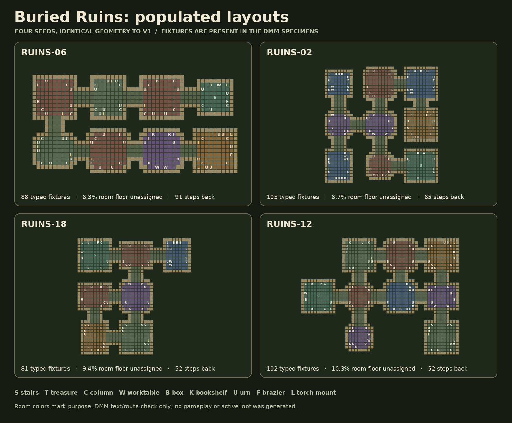

# Furnished Buried Ruins

These are furnished versions of the four [geometry-only seeds](PREVIEWS.md).
Room outlines and corridors did not change. Role-specific old stone and
cobblestone variants distinguish selected room floor zones. The generator assigns each room a
purpose and a footprint, places role-specific fixtures at actual map coordinates,
and reserves unobstructed movement and encounter space before adding objects.
The fixture placements are reflected in the DMM specimens used for independent
parseback, not just painted onto the render.

| Seed | Typed placements | Unassigned room floor | Steps from vault goal back to entry |
| --- | ---: | ---: | ---: |
| [ruins-06](furnished/ruins-06.json) | 88 | 36 / 568 (6.3%) | 91 |
| [ruins-02](furnished/ruins-02.json) | 105 | 39 / 581 (6.7%) | 65 |
| [ruins-18](furnished/ruins-18.json) | 81 | 46 / 491 (9.4%) | 52 |
| [ruins-12](furnished/ruins-12.json) | 102 | 65 / 631 (10.3%) | 52 |

"Unassigned" means room-floor cells not occupied by a fixture, reserved for
circulation, reserved for assembly/combat, or in a one-tile working apron of a
fixture. Categories do not double-count. It is a geometric review measure,
not visual fidelity, combat balance, or a claim that interiors are 90% blocked.
The open arrival and vault centers are deliberate. The largest rooms should still
be recognizable by the placement of supports, perimeter objects and objectives.

## Room programs

| Room | What the layout reserves or places |
| --- | --- |
| Arrival guardroom | Visible stair marker, a clear assembly floor, storage and supports |
| Processional hall | Clear connected floor, column pairs and perimeter fixtures |
| Collapsed watchpost | An open encounter pocket, asymmetric obstacles and landmark props |
| Supply storeroom | Storage rows and a clear approach to an optional cache |
| Scribe workshop | Worktables and bookcases along the room edge, with an open circulation lane |
| Reliquary vault | Clear encounter floor, column framing, and a distinct reachable treasure alcove |

Each record declares the room geometry, program, object path/coordinate, and
the fixture's reserved/solid footprint. They distinguish solid supports,
containers and furnishings from nonblocking torch mounts and the stair marker.
Props are stock Civ13 types, but collision, light, opening behavior,
line of sight and combat have not been verified in a BYOND client. The specimen
chests do not award loot and the stair is not a functioning transfer portal.

## Validation after furnishings

The [offline receipt](furnished/furnished-validation.json) records the exact
layout, map-projection and preview hashes.

- A cardinal 3 x 3 footprint can traverse every declared corridor, branch,
  and loop, reach every room, and return; shortest out-and-back distances
  match the unfurnished cases.
- Every mapped reward socket has a cardinal one-tile interaction approach
  reachable on foot without stepping onto its object. The 3 x 3 check models
  travel clearance, not final person-to-container reach.
- An independent pass reconstructed all room extents and unassigned metrics,
  compared every typed DMM object to its manifest, and rejected twelve
  injected errors (overlap, outside-room and obstructed required footprint,
  each across four seeds).
- The contact sheet is a layout view. The separate sprite montage uses
  existing Civ13 sprites at 21 x 15 tiles per view. Neither is a native game
  capture, calibration of the expedition timer, or evidence of transfer,
  combat, save/load or loot.

For review, start with **ruins-02** to compare the guardroom and vault with the
bare draft and ask whether the open centers read as gathering/fighting space.
Then check **ruins-12** for branch and loop variety. Keep the return lane clear;
add a chamber-specific focal prop or visual flooring before crowding the center.
