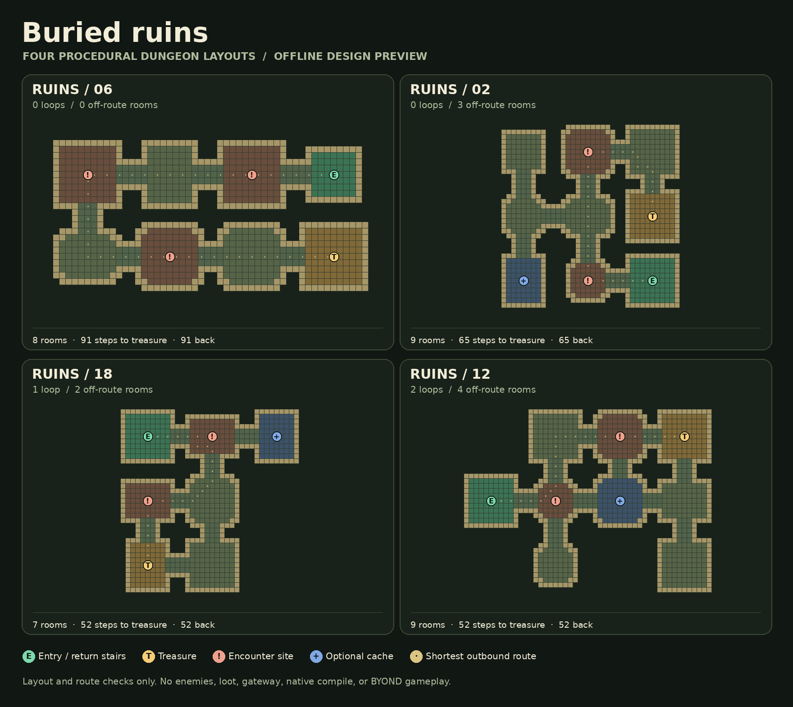

# Buried Ruins: four seeded layout previews

These are four intentionally different seeds chosen from a 30-seed offline
trial of one experimental profile, not a distribution or balance sample.

| Seed | Envelope | Rooms | Loops | Off shortest route | Steps out and back |
| --- | --- | ---: | ---: | ---: | ---: |
| [ruins-06](preview/ruins-06.json) | 53 x 27 | 8 | 0 | 0 | 91 each way |
| [ruins-02](preview/ruins-02.json) | 40 x 40 | 9 | 0 | 3 | 65 each way |
| [ruins-18](preview/ruins-18.json) | 39 x 40 | 7 | 1 | 2 | 52 each way |
| [ruins-12](preview/ruins-12.json) | 53 x 40 | 9 | 2 | 4 | 52 each way |

Start play-design review with **ruins-02**: the entrance route is clear and
its optional branches let a timer create a meaningful choice without
requiring loop navigation on the first visit. Use **ruins-12** to test whether
alternate routes and optional rooms work once players know the rules. Route
lengths are grid steps, not a calibrated travel time.

The bounded generator samples connected room graphs on a 4 x 3 lattice,
uses variable-size rooms and three-tile corridors, and seeds Python's PRNG
from SHA-256 of the seed label. Repeat on the same Python major/minor to
reproduce. The offline audit verified deterministic outputs, cardinal
reachability with a 3 x 3 clearance footprint, and a return route to the
entrance. Its DMM projection uses the pinned Liminal geometry writer and
parser and parsed exactly back into the generated turf/area grid. The
[full receipt](preview/receipt.json) hashes the figures, JSON and DMM
artifacts in the separate review pack; only the sheet, four JSON layouts
and receipt are stored in this PR.

These colors and markers are schematic. There are no actual stairs, doors,
encounters, loot, countdown, shuttle, native sprite capture or playable region
in this draft. No DreamMaker DMM compile or BYOND gameplay was performed.
