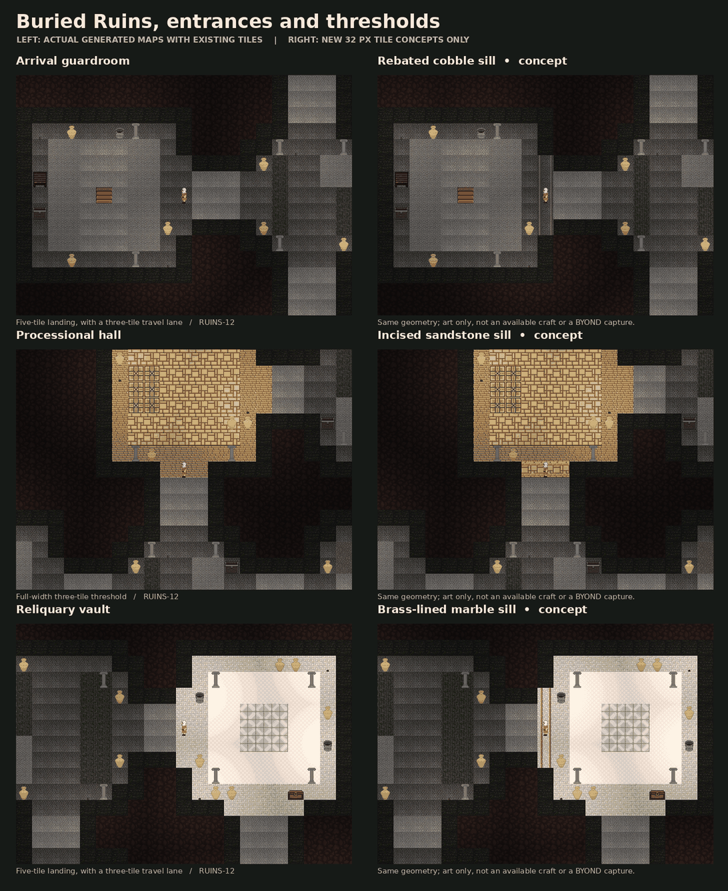

# Room thresholds and constructible floors

Keep the approved three-finish [room palettes](COHESIVE_FLOORS.md). This
iteration makes the passage into a room readable: stock edge material spans
the whole three-tile lane. Where there is room to widen a guardroom or vault
entrance without opening another route, add one shoulder on each side of
the lane so someone can wait clear of traffic. This makes those landings
five tiles wide at the threshold only. No doors, props, collision rules,
new rooms or raised steps are introduced.

The panels at left are sprite renders of the generated DMMs. The panels
at right show three optional painted concepts at the same sites: rebated
cobblestone, incised sandstone and brass-lined marble sills. The 32 px tile
concepts are not game assets, are not used by the four DMMs and cannot be
crafted. The composited lighting and example character are for illustration,
not BYOND client output.

| Seed | Three-wide threshold bands | Widened landings | Clear 3 × 3 return distance |
| --- | ---: | ---: | ---: |
| ruins-06 | 14 | 2 | 91 |
| ruins-02 | 16 | 2 | 65 |
| ruins-18 | 14 | 3 | 52 |
| ruins-12 | 20 | 3 | 52 |

The [exact transition receipt](thresholds/exact-transition-receipt.json)
identifies the paired DMM/manifests by hash and records the cross-section and
optional shoulder coordinates. Independent readback confirmed the 64 declared
bands, 20 new shoulder floor cells, unchanged room interiors and fixtures,
existing 3 × 3 centerline clearance, unchanged shortest returns and reachable
one-tile cardinal chest/cache approaches. A blocked sill and an unlisted
carved wall were rejected for each seed. These are offline geometry checks, not
persistence, multiplayer or runtime validation.

## What players can lay today

At source revision `a7ef0b472b2b5cc07a6f1dd6852a7a5bfa1b9521`, nine of the
14 exact finishes in the approved palette had global placement recipes. The
audit matched exact output paths across all 11 material-recipe files,
research maps and the checked-in generated Atlas. It does not establish
that a given map supplies the required material, that a character has met
the unlock, or that a connected client exposes the path as expected.

| Exact finish | Existing global route | Research node |
| --- | --- | --- |
| Slate floor | 1 stone | Stone Masonry |
| Carved stone slab floor | 1 stone | Stone Masonry |
| Sandstone brick floor | 1 sandstone | Stone Masonry |
| Sandstone slab floor | 1 sandstone | Stone Masonry |
| Sandstone decorative tile | 2.5 sandstone | Stone Masonry |
| Stone brick floor | 1 stone brick | Brickmaking |
| Plain white marble, marble grid, or ornate marble inset | 1 marble each | Imperial Architecture |

These place the floor at the worksite from a material stack rather than
handing out a portable floor tile. There is a separate path to apply tinted
limewash to eligible installed floors, but it changes color, not paving
geometry or the chosen sprite. The ordinary stone brick row uses the
`none` category, unlike the other audited rows, but is still registered.

### Exact gaps worth filling first

- The dungeon uses light and dark horizontal cobble and light vertical
  cobble as mapped turfs. None has an exact construction recipe. The
  craftable **cobblestone floor** is a fixed dark vertical cover
  (`floors.dmi:cobble_vertical_dark`), not the same three finishes. The
  auto-joining **smooth cobble road** also uses different art and behavior.
- The plain **Roman setts** uses the static
  `/obj/covers/romanroad` (`floors.dmi:roman_road`) with no recipe. The
  similarly named craftable Roman road registers another path,
  `/obj/covers/roads/roman` (`roads.dmi:r_road` and joined variants).
  Existing road recipes and map assets should keep their behavior.
- **Mossy old stone** also has no exact craft route. Keep it map-only to
  signal natural wear; it need not be a new craftable building material.
- **Sandstone and marble** already have workable field, border and inset
  options. More variants in those families are optional decorations,
  not blockers. Prefer a deliberately legible matched sill if we need
  something the existing finishes cannot already show.

A narrow source follow-up can register the three missing static cobble
finishes as dedicated passable floor covers under Stone Masonry, using
their existing DMI states: one stone, 25 deciseconds, one per floor slot,
like the current dark-vertical cover. Use explicit recipe paths and names
rather than rotation or aliasing roads. If we want the Roman-sett texture
as a constructible **interior** floor, use a distinct `Roman sett floor`
cover under Paved Infrastructure with the same starting cost; the stock
static road type is explicitly treated as road by cartography/finish
rules. Do not silently turn old roads into paintable interiors or alter
cobble turfs. These are proposed costs and gates, not existing content.

Reuse the common pad/occupancy, roof-linked subfloor replacement,
hammer teardown and saves; no independent flooring system is needed.
Before making these source changes available, validate exact recipe
paths/Atlas entries, gate enforcement, placement and wrong-terrain
refusal, occupied-tile and interrupted-build no-debit behavior, upper-floor
replacement/refund, visible art and save/reload. Keep access and road
joining behavior unchanged. None of the proposed new recipes or art is
registered by this docs-only draft.

Source references: [global stone floor rows](../../config/crafting/material_recipes_global.txt#L1584-L1591),
[marble rows](../../config/crafting/material_recipes_global.txt#L1718-L1733),
[sandstone rows](../../config/crafting/material_recipes_global.txt#L3205-L3210),
[map-only cobble and old stone declarations](../../code/game/turfs/floor_types.dm#L627-L655),
[static cobblestone and Roman setts](../../code/game/objects/covers_types/cover_floortypes.dm#L224-L280),
[auto-joining roads](../../code/game/objects/covers_types/cover_roads.dm#L27-L69),
[floor occupancy, replacement and teardown](../../code/game/objects/tile_occupancy.dm#L9-L120),
[direct placement and material payment](../../code/game/objects/items/stacks/stack.dm#L1816-L1907).
