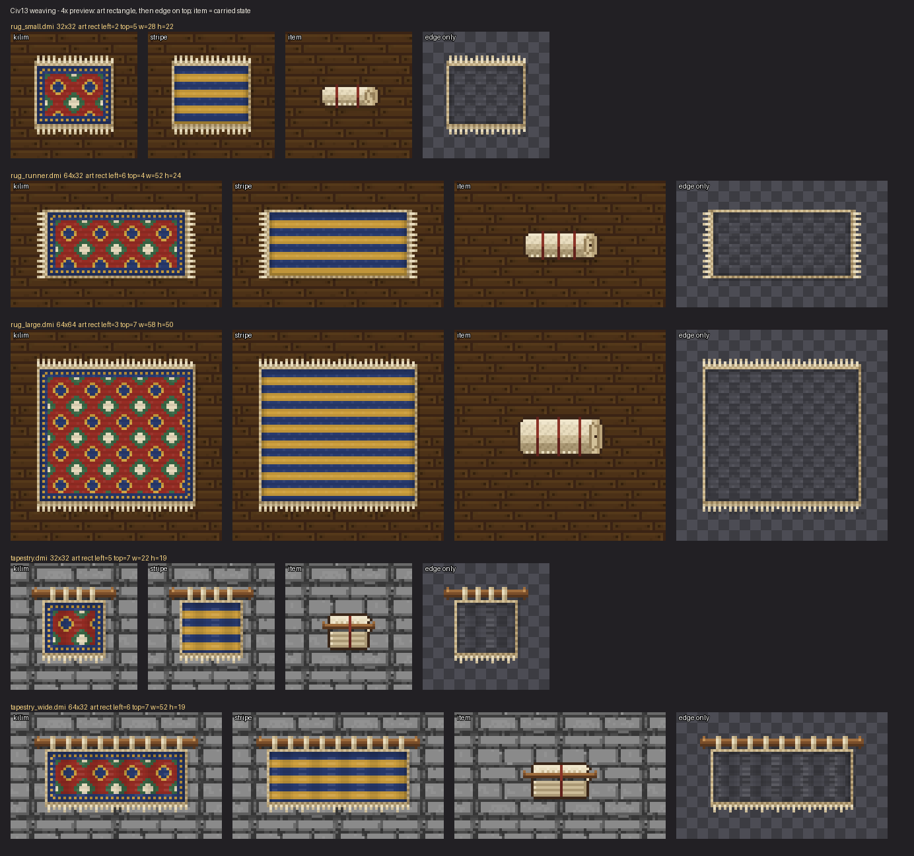

# Woven rugs and tapestries

`code/modules/1713/woven_art.dm`. Part of the homes and towns plan (phase 2).

- **Warps** (cloth, Weaving): small rug (2 cloth, 1 tile), runner (3, 2x1),
  large rug (6, 2x2), tapestry (2, 1 tile), wide tapestry (3, 2 tiles on a
  wall to the north).
- **Weaving**: hold the warp beside a loom and use it. The painting editor
  opens at the size the piece shows (28x22 up to 58x50), pixel for pixel.
  Colours are the dyes the weaver knows (`tailoring_known_dyes`, every named
  dye with Textile Mills) and their half mixes; carried pigments are not used
  (`uses_pigments = FALSE`). Finished pieces count toward the region painting
  cap (0.25 to 1 each).
- **Rugs**: click a floor tile with a finished rug to lay it
  (`/obj/structure/woven_rug`, layer 2.05); the Roll Up Rug verb takes it
  back. A rug is art for mood and covers its footprint for a home's floor
  category (`woven_rug_covers`).
- **Tapestries**: hang on a wall like a painting (`painting_hang`; the
  canvas `wide_hang` var replaces the old gallery format check) and count as
  art like any hung painting.

Sprites: Fable, `icons/obj/woven_<format>.dmi` (`blank`, `edge`, `item`),
generator `tests/sprites/create_woven_art.py OUT_DIR`; carried rolls cropped
into `icons/obj/woven_items.dmi` by `tests/sprites/create_woven_items.py`.

Test: `python3 tests/ecology_spawning/run_linux.py . tests/woven_art/probe.dm`.
