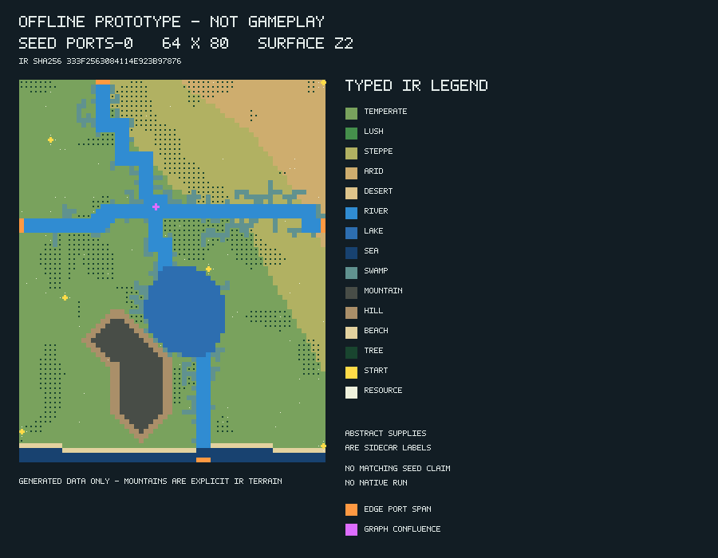

# Small reproducible examples

The JSON files are complete configuration inputs. The `surface-ports-coast-*`
examples use schema 2 and explicit side/span controls at reference dimensions;
the three original files retain legacy profile configs. `oceanic-islands.json`
uses schema 3 and the implemented oceanic backend. Legacy `oceanic.json` and
cavern generation still reject explicitly; no automatic migration occurs.

For a fast, reproducible small example, run from repository root:

```sh
python3 -m tools.procedural_maps preset --out data/procedural_maps/small-config.json
python3 -m tools.procedural_maps generate --config data/procedural_maps/small-config.json --out data/procedural_maps/small-map
python3 -m tools.procedural_maps verify data/procedural_maps/small-map
```

This 64 x 80 schema-2 `ports-0` example has semantic IR SHA-256
`333f2563084114e923b97876dc92728839fded10637a97763e7460e6f9d50d07`.
The suite also retains the legacy small-map golden vector. The complete IR,
sidecar and DMM are generated into ignored `data/`, rather than committing large
raw files. The optional preview here is original generated-data output, not a
game capture, reference image or third-party asset.


